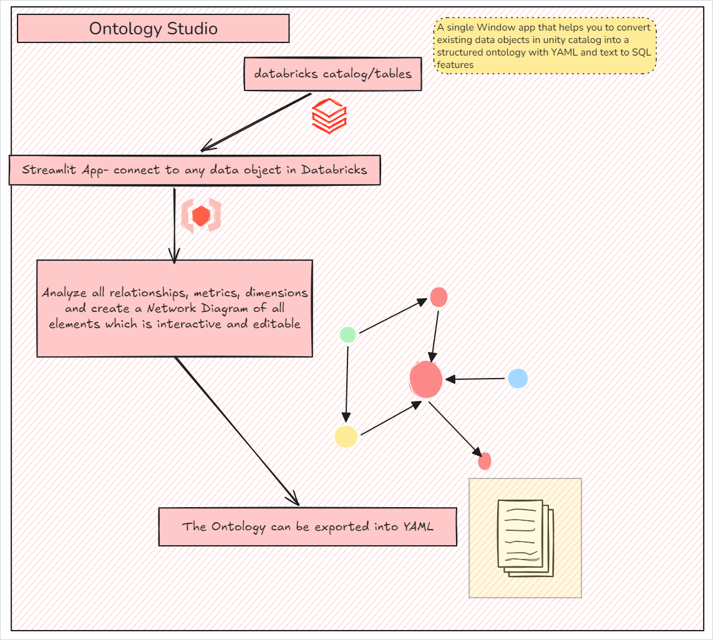
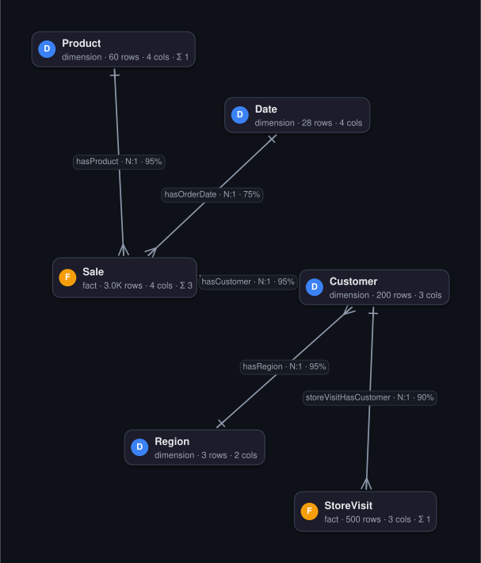
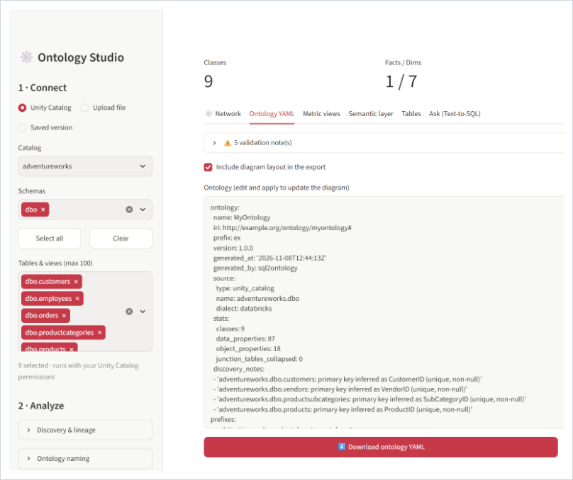
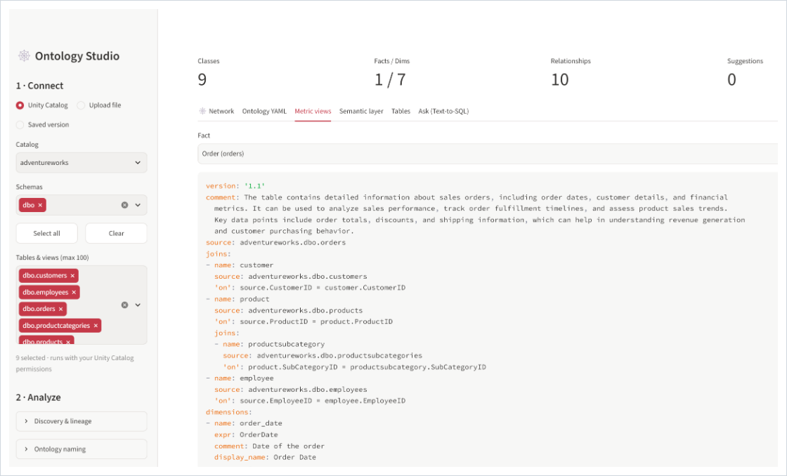
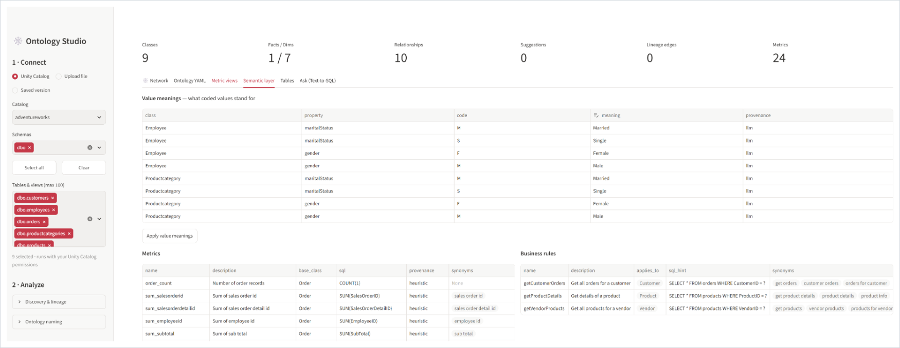
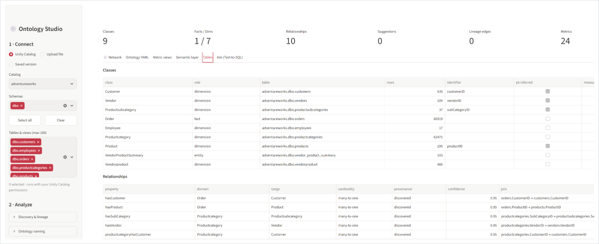
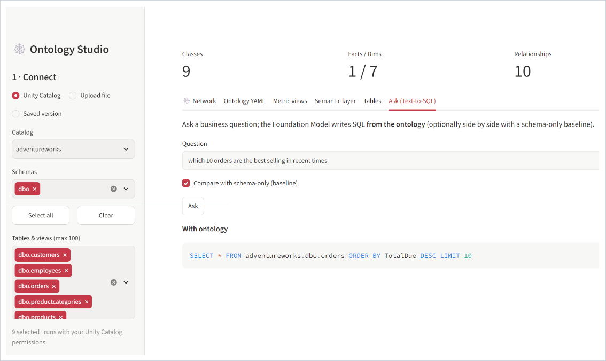
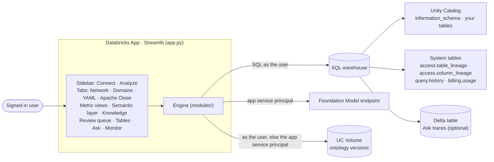

# Ontology Studio

**Turn a set of Unity Catalog tables into a governed semantic layer: an editable ontology plus Databricks metric views.**

Ontology Studio (`sql2ontology`) is a Streamlit app that runs on [Databricks Apps](https://docs.databricks.com/aws/en/dev-tools/databricks-apps/). Point it at up to 100 tables and views in Unity Catalog. It works out how they fit together, even when no foreign keys are declared. You fix what it got wrong on an interactive diagram, then export what you keep:

1. **An ontology YAML file.** Classes, properties, relationships, code meanings, business rules, metrics, synonyms and lineage, with provenance on every element.
2. **Databricks metric views** (YAML spec 1.1), one per fact table. Download them, or deploy them to Unity Catalog in one click.
3. **An [Apache Ossie](https://github.com/apache/ossie) semantic model** (`0.3.0.dev0`), the vendor-neutral exchange format, checked against the official specification before you download it.

Already have an Ossie model? Upload it: the app validates it against the official spec (schema plus the reference validator's semantic checks), shows every problem with its line number and a fix, and loads valid models into the same editor.

Every SQL statement runs **as the signed-in user** (on-behalf-of-user authorization), so Unity Catalog grants, row filters and column masks still apply. The app never reads data the user couldn't already read.

The workflow is **Connect → Analyze → Edit → Export**. An **Ask** tab then shows whether the ontology actually helps an LLM: it writes SQL for the same question with and without the ontology, side by side.

On top of the modeled ontology, the studio keeps it governed and learning: **domains** that narrow what Ask searches, **certified** metrics and tables, governed wiki **pages**, **learned snippets** mined from query history with an authority score, a **review queue** that proposes what to promote or certify, and a **monitor** with request traces, feedback, cost and per-user budgets. See [Govern and learn](#7-govern-and-learn-domains-certification-pages-learned-snippets).

No Databricks workspace handy? The same engine runs locally on a SQLite file or a `.sql` script, in the app or from a [command-line interface](#command-line-interface).

<p align="center">
  
</p>

## Walkthrough

These screenshots use the AdventureWorks sample tables (`adventureworks.dbo`) in Unity Catalog; the network diagram uses the bundled `retail_star.db` sample. Click an image to see it full size.

### 1. Pick tables, build, and edit the network

In the sidebar, choose **Unity Catalog**, a catalog, one or more schemas and up to 100 tables, then click **Analyze & build**. The **Network** tab draws every class as a card (**F** amber for facts, **D** blue for dimensions, **E** grey for entities) with its row, column and measure counts, and every relationship with crow's-foot ends on the many side. Click a class to edit its role, description, synonyms, column roles and metrics in the inspector on the right.



### 2. Review the ontology YAML

The **Ontology YAML** tab shows the whole ontology, with validation notes at the top. Edit the YAML and click **Apply YAML edits** to update the diagram, or download it.



### 3. Generate metric views

The **Metric views** tab builds one metric view per fact, with joins nested for snowflake schemas. Download it, or deploy it to Unity Catalog.



### 4. Check the semantic layer

The **Semantic layer** tab lists code meanings, metrics and business rules, each with its provenance. Here the LLM filled in the code meanings and the business rules.



### 5. Review tables and relationships

The **Tables** tab lists every class with its source table, row count and key (ticked when the key was inferred), and every relationship with its join columns and confidence.



### 6. Ask a question

The **Ask (Text-to-SQL)** tab writes SQL for a business question from the ontology and runs it as you. With **Compare with schema-only** ticked, it also shows a baseline written from the bare table and column names.



---

## Features

### 1. Connect

- **Unity Catalog** (on Databricks): pick a catalog, one or more of its schemas, and up to 100 tables and views from those schemas. Declared foreign keys that point into another schema or catalog are resolved too.
- **Upload a file**: a SQLite database (`.db`, `.sqlite`, `.sqlite3`) or a SQL script (`.sql`, `.ddl`, `.txt`). With the dialect on **auto**, a script first runs in an in-memory SQLite database, so dumps with `INSERT`s get profiled too. Otherwise, or if that fails, the DDL is parsed with [sqlglot](https://github.com/tobymao/sqlglot) in the dialect you pick: MySQL, Postgres, T-SQL, Oracle, Snowflake, Databricks, BigQuery, Redshift, DuckDB or Teradata.
- **Ossie YAML**: an [Apache Ossie](https://github.com/apache/ossie) semantic model (`.yaml`, `.yml` or `.json`). It is validated first (see [Apache Ossie](#6-apache-ossie-validation-import-and-export)) and loads into the editor when it passes.
- **Saved version**: reload an ontology you saved earlier to a Unity Catalog Volume (needs [`ONTOLOGY_STORE`](#configuration)).

### 2. Analyze

| Step | What it does |
|---|---|
| **Objects** | Reads `information_schema` in each catalog: tables, views, columns, comments, and primary key, unique and foreign key constraints. Declared foreign keys resolve across schemas and catalogs. |
| **Profiling** | Row counts, distinct counts (`approx_count_distinct` on Unity Catalog), non-null counts, up to 5 sample values per column, and the distinct values of low-cardinality text columns (enumerations). On Unity Catalog it profiles 8 tables in parallel and skips complex types (`ARRAY`, `MAP`, `STRUCT`, `VARIANT`, …). |
| **Primary keys** | Uses declared keys. Where there are none, it infers one from a unique, non-null column with a key-like name (`*_id`, `*_key`, `*_sk`, `*_code`, …) or a name that starts with the table's entity. Needs profiling, which is on by default. |
| **Relationships** | Scores every candidate join from five signals (below). Strong joins are accepted; the rest become suggestions for you to review. |
| **Lineage** | Reads `system.access.table_lineage` and `system.access.column_lineage` (last 180 days by default). Upstream and downstream tables outside your selection appear as external nodes. |
| **Semantics** | Classifies each class as **fact**, **dimension** or **entity**, and each column as **key**, **time**, **measure** or **dimension**. Measures get a default aggregation: `AVG` for prices, rates and ratios, otherwise `SUM`. Every fact gets base metrics: a row count plus one metric per measure. |
| **LLM enrichment** (optional) | Fills in descriptions, synonyms, code meanings, business rules and metrics, grounded in documents you upload (below). |

#### How relationships are found

Unity Catalog constraints are informational and often missing, so each candidate join collects evidence and gets one confidence score between 0 and 1:

| Signal | Effect on the score |
|---|---|
| Declared foreign key | Taken as given (1.0). |
| Naming | Same name as the target's key, e.g. `fact_sales.customer_key = dim_customer.customer_key` (0.60). A column that names the entity, e.g. `cust_id → customers` (0.55). A column that ends with the key's name (0.40). |
| Type check | −0.30 when one side is numeric and the other is text. |
| Value overlap | A sampled `LEFT JOIN` for the top 80 candidates: what share of up to 5,000 distinct child values exist in the parent key. ≥ 98% adds 0.35, ≥ 90% adds 0.25, ≥ 70% adds 0.10, anything lower subtracts 0.50. |
| Query history | Equality joins that people actually ran, parsed with sqlglot from finished `SELECT`s in `system.query.history` (last 90 days, up to 3,000 statements). Raises the score to at least 0.45, plus up to 0.30 more the more often the join appears. |

The best target per child column wins. Joins at or above the threshold (0.75 by default, adjustable in the sidebar) become relationships. Joins between 0.30 and the threshold become **suggestions**, with their evidence attached, which you accept or reject. Nothing is added silently.

If the query text in `system.query.history` is redacted for the user, the app skips that signal and says so.

#### LLM enrichment, grounded in your documents

On Databricks, tick the LLM option and upload a data dictionary, KPI definitions or code lists (`.md`, `.txt`, `.csv`, `.json`, `.yaml`). The Foundation Model endpoint then adds:

- descriptions and synonyms for classes and columns,
- **value meanings** for coded columns (`line_cd: M → Mountain`),
- **business rules** with SQL hints (*fiscal year starts 1 July*),
- **metrics** with SQL expressions (*AOV = SUM(subtotal) / COUNT(order)*).

Guardrails:

- The model is told to use only the classes and columns it was given.
- It only fills **empty** descriptions and code meanings. It never overwrites what came from the schema.
- Rules and metrics that point at unknown classes are dropped.
- Everything it adds is tagged `provenance: docs/<file>` when a document supports it, or `provenance: llm` when it doesn't.

Classes go to the model in batches of 25, with up to 60,000 characters of your documents.

### 3. Edit

**The network diagram** (D3.js, bundled with the app, no CDN):

- **Nodes** are cards with a role badge (**F** fact, **D** dimension, **E** entity, **B** bridge) and their row, column and measure counts. Dashed outlines are external tables that only appear in lineage. Hover a card for its table, description and columns (🔑 keys, 🕒 time, Σ measures).
- **Edges:** relationships are labelled with name, cardinality and confidence, with crow's-foot ends (many-to-one, one-to-one, many-to-many). Dashed orange lines are suggestions. Animated dotted green lines are lineage. Parallel relationships curve apart and self-references loop.
- **Toolbar:**
  - **＋ Connect:** drag from the class that holds the key to the class it points to (or click both). The app guesses the join columns; check them in the inspector.
  - **Repoint target / Repoint source:** select a relationship, then click its new class.
  - **Delete** the selected relationship. **✓ Accept** or **✕ Reject** the selected suggestion.
  - **Layouts:** force-directed, layered (facts on the left, dimensions to the right) and radial (facts in the centre). **Re-layout**, **Fit**, zoom, full screen, **Find class…**, a minimap, and show/hide toggles for relationships, suggestions, lineage, labels and the minimap.
  - **SVG / PNG** download of the diagram.
  - Keyboard: `C` connect, `Del` delete, `Esc` cancel, `F` fit, `L` re-layout, `/` find. Double-click a class to focus on it and its neighbours.
- **Drag nodes** to arrange them. Positions are saved in the ontology (`layout:`), so the diagram looks the same next time.

**The inspector** (right panel) edits whatever you click:

- **Class:** rename it, set its role (fact, dimension, entity or bridge), description and synonyms; set each column's role, aggregation and description; add, replace or delete metrics.
- **Relationship:** name, cardinality and the join columns on both sides, or delete it.
- **Suggestion:** confidence and evidence, then accept or reject.
- **Lineage edge:** event count, when it was last seen, and the column mappings.
- **Nothing selected:** add a relationship from a form, accept every suggestion at 60% or more, reject them all, or re-run the classification.

**Other tabs:**

- **Apache Ossie:** the validation report of the uploaded file, the export of the current ontology, and a box to validate any pasted document. See [below](#6-apache-ossie-validation-import-and-export).
- **Ontology YAML:** edit the YAML and click **Apply YAML edits** to redraw the diagram. Validation notes flag relationships that point at missing classes, inverses that don't point back, classes without an identifier, and coded values that still have no meaning.
- **Semantic layer:** edit value meanings, and review metrics, business rules and the synonyms index.
- **Tables:** classes, relationships and suggestions as plain tables.

### 4. Export

**Ontology YAML.** Readable and diff-able, so it can live in git. Trimmed from [`samples/retail_star.ontology.yaml`](samples/retail_star.ontology.yaml):

```yaml
classes:
  Customer:
    source_table: dim_customer
    identifier: [customerKey]
    identifier_inferred: true
    role: dimension
object_properties:
  hasRegion:
    domain: Customer
    range: Region
    cardinality: many-to-one
    inverse: hasCustomers
    join:
      from: [dim_customer.region_code]
      to: [dim_region.region_code]
    confidence: 0.95
    provenance: discovered
```

The file also carries `value_meanings`, `rules`, `metrics`, `suggested_relationships`, `lineage`, a `synonyms_index` (business term → class, column, metric or rule), the diagram `layout`, and standard RDF/OWL/XSD prefixes.

**Databricks metric views** (YAML spec 1.1), one per fact:

- many-to-one joins from the fact, nested for snowflake schemas (up to 3 levels deep),
- dimensions from the fact and from every class it joins to,
- measures from the ontology's metrics, plus an aggregate for each measure column that has no metric yet.

Trimmed from [`samples/metric_views/sale_metrics.yaml`](samples/metric_views/sale_metrics.yaml):

```yaml
version: '1.1'
source: fact_sales
joins:
- name: customer
  source: dim_customer
  'on': source.customer_key = customer.customer_key
  joins:
  - name: region
    source: dim_region
    'on': customer.region_code = region.region_code
dimensions:
- name: region_name
  expr: customer.region.region_name
  display_name: Region Name
measures:
- name: sum_net_amount
  expr: SUM(net_amount)
  display_name: Sum Net Amount
```

In the **Metric views** tab you can:

- download one view as YAML,
- download a zip with every view, its `CREATE OR REPLACE VIEW … WITH METRICS LANGUAGE YAML` statement, and the ontology,
- or click **🚀 Deploy to Unity Catalog**. This runs the `CREATE` statement as you, so you need `CREATE TABLE` on the target schema. It is available when the source is Unity Catalog. The target defaults to `<fact's catalog>.<fact's schema>.<fact>_metrics`, and you can change it.

**Apache Ossie.** The **Apache Ossie** tab exports the ontology as an Ossie `0.3.0.dev0` document (YAML or JSON) and validates it before you download it. See [below](#6-apache-ossie-validation-import-and-export).

**Versions.** With `ONTOLOGY_STORE` set, **💾 Save version to Volume** (in the Ontology YAML tab) writes `<ONTOLOGY_STORE>/<ontology name>/<UTC timestamp>.yaml` plus a `latest.yaml`. Reload any of them from **Saved version** in the sidebar.

### 5. Ask: test the ontology

Type a business question. The Foundation Model writes SQL **from the ontology** (classes, synonyms, joins, code meanings, rules and metrics). With **Compare with schema-only** on, it also writes a **baseline** query from the bare table and column names, so you can see both SQL statements and both result sets side by side.

How Ask works out an answer:

1. **Focus.** It matches the question's words against class, column and metric names, labels, synonyms and page titles, and puts the best matches (tables, the joins between them, metrics with their SQL, certified first) at the top of the prompt.
2. **Plan and write.** The model answers with JSON: a short reasoning, the assumptions it made, and one query. The prompt tells it to reuse metric and snippet definitions instead of inventing formulas, join only along declared relationships, respect the grain ("for each month in 1997" means one row per month, filtered to 1997, in order), return readable labels, and use the dialect's date functions.
3. **Check.** The query must parse (sqlglot, in the source's dialect) and be a single read-only `SELECT` / `WITH`.
4. **Run and self-correct.** It runs on Unity Catalog as you, or on the uploaded SQLite file. If it fails, the error goes back to the model to fix its own query (up to three attempts in total); an empty result gets one retry. **How it answered** shows the reasoning, assumptions and every corrected attempt.

Profiled sample values (Decimal, dates, bytes from Unity Catalog) are converted before they go into the prompt. The Ask tab needs the model endpoint, so it works on Databricks only.

### 6. Apache Ossie: validation, import and export

[Apache Ossie](https://github.com/apache/ossie) (incubating, formerly Open Semantic Interchange) is a vendor-neutral YAML/JSON format for one semantic model: datasets, relationships, fields and metrics, with per-dialect SQL and AI context.

**Validation.** Choose **Ossie YAML** in the sidebar and upload a file. It is checked against the official JSON Schema of the version it declares, bundled from apache/ossie in [`modules/ossie/schemas/`](modules/ossie/schemas/):

| Declared `version` | Status | Notes |
|---|---|---|
| `0.3.0.dev0` | current development version | `nonportable_extensions` with object `data` |
| `0.2.0.dev0` | former development label | `custom_extensions` with JSON-string `data`; passes with a warning |
| `0.1.1` | first release (2025-12-11) | models wrapped in a `semantic_model` list; passes with a warning |

Tick **Require the current spec version** to treat anything older than `0.3.0.dev0` as an error. After the schema, the semantic checks follow the reference validator (`validation/validate.py` in apache/ossie):

| Check | Severity |
|---|---|
| YAML/JSON parses as one document, no duplicate keys, a mapping at the root | error |
| JSON Schema: required properties, types, `DataType` values, expression shape, no unknown keys (with "did you mean" hints and migration hints such as `custom_extensions` → `nonportable_extensions`) | error |
| Extension `data` is JSON: no dates, NaN or non-string keys; unquoted YAML scalars that readers disagree on | error / warning |
| Unique dataset, field, metric and relationship names; fields and dataset-scoped metrics share one namespace | error |
| Relationships name declared datasets; keys and join columns name declared fields | error (warning for older versions) |
| `from_columns` and `to_columns` have the same length | error |
| Dataset-scoped metrics use their own fields unqualified, or `source.column` | error |
| Every SQL-family expression parses as one expression (sqlglot) | error |
| Model metrics use `dataset.field`; `to_columns` covers a key; field shadowing; dialect variants agree; no `NOW()` / `RANDOM()` | warning |
| Modelling lints: aggregates in fields, metrics without an aggregate, duplicate dialects or relationships, case-only name clashes, fieldless or isolated datasets, ambiguous synonyms | warning / note |

As in the reference validator, the semantic checks run once the schema errors are fixed. The report lists each finding with its path, line number and a fix, and downloads as Markdown. Older documents get an **Upgrade to 0.3.0.dev0** button that rewrites them in the current shape (unwraps `semantic_model`, renames `custom_extensions`, turns JSON-string data into objects, declares fields that keys name) and re-validates the result.

**Import.** **Load Ossie model** turns datasets into classes, fields into properties (`datatype` → XSD range, `is_time` → time role, computed expressions kept), relationships into many-to-one joins, and metrics into metrics whose SQL is rewritten to source columns, so metric views and the Ask tab work on imported models. When every dataset source is a `catalog.schema.table` name, Ask and metric view deploys run against Unity Catalog.

**Export.** The **Apache Ossie** tab exports any ontology as `0.3.0.dev0`. Join columns become declared fields, many-to-many relationships become their junction dataset plus two relationships, and code meanings go into `ai_context`. Studio-only details (roles, aggregations, rules, provenance, optionally the layout) travel in `nonportable_extensions` under `ONTOLOGY_STUDIO`, so a round trip through Ossie loses nothing. The export is validated before you download it.

### 7. Govern and learn: domains, certification, pages, learned snippets

These features follow the ideas in Databricks' Genie ontology (a curated, *modeled* head plus a *learned* tail), built from what a Databricks App can reach: Unity Catalog, system tables and the SQL warehouse.

**🏠 Domains (ontology home).** A domain is a tag for a logical group of assets: Sales, Finance, Supply chain, a region. Subdomains have a parent (`Supply chain/Logistics`), and a table can live in several domains. **✨ Suggest domains** guesses them from table names and joins (a fact takes the domain of the dimensions it references); metrics and rules inherit their base class's domains. The home tab shows a domain map with the tables, metrics, pages and snippets of each domain, and lets you assign tables, certify them and set owners. **Unity Catalog tags** writes `ontology_domain`, `ontology_certification` and `ontology_owner` tags on the source tables (`ALTER TABLE … SET TAGS`, needs `APPLY TAG`), and **Read tags** loads them back; analysis also reads them, so domains tagged once show up in every new ontology.

**Governed metrics.** Every metric, rule, page and table has a status: `draft`, `certified` or `deprecated`, with an owner and who certified it when. Ask marks certified definitions `certified: true` so the model prefers them, and never sends deprecated ones. Editing a certified metric sets it back to draft.

**📚 Pages.** A page is the qualitative counterpart of a metric: a governed Markdown wiki page that explains a concept (net vs gross revenue, what "late" means). Pages have domains, an owner, a status, synonyms and links to classes, metrics and rules. Certified pages go into the Ask prompt first. Download them all as a zip of Markdown files with front matter.

**🧠 Learned snippets.** The studio parses the SQL people actually run (sqlglot) into snippets:

| Kind | Example |
|---|---|
| join | `OrderDetail.ProductID = Product.ProductID` |
| filter | `Order.ShippedDate > Order.RequiredDate` (each `WHERE` condition) |
| expression | `SUM(OrderDetail.UnitPrice * OrderDetail.Quantity * (1 - OrderDetail.Discount))` named `net_revenue` |

Sources: `system.query.history` for the ontology's tables (with `executed_by` and `query_source`, so it knows whether a query came from a dashboard, Genie space, notebook, job, alert or the SQL editor), an uploaded `.sql` / `.csv` query log, and Ask answers that got a 👍. Each snippet gets an **authority score** from 0 to 1, a transparent weighted blend shown for every snippet:

| Signal | Weight | Meaning |
|---|---|---|
| popularity | 0.30 | how often it is used (log scale) |
| reach | 0.20 | how many different people use it |
| author | 0.15 | how authoritative its authors are: volume of work, how much of it is shared, how often others reuse their snippets, plus a +0.3 boost for **trusted authors** you name |
| sharing | 0.15 | share of uses in shared assets (dashboards, Genie spaces, jobs, alerts) |
| documented | 0.10 | someone explained it in a SQL comment |
| recency | 0.10 | halves every 90 days |

Snippets with authority ≥ 0.35 (or promoted ones) go into the Ask prompt as examples of how colleagues query the data. **🧑‍🏫 Experts** ranks people per table by authority-weighted use, so you know whom to ask. Try it with **Sample: Northwind query log** ([`samples/query_logs/northwind_query_log.csv`](samples/query_logs/northwind_query_log.csv), 60 queries by five people) on a Northwind SQLite database.

**✅ Review queue.** The studio proposes what an admin should promote, certify or explain, highest priority first:

| Item | Fires when | Actions |
|---|---|---|
| 🔥 Popular snippet | authority ≥ 0.5 and not yet a relationship, metric or rule | promote to metric / rule / relationship, draft a page, dismiss |
| ⚖️ Conflicting definitions | one name with several formulas (`net_revenue` vs `revenue`) | draft a page that settles it, certify one metric (the others are deprecated) |
| 📝 Needs certification | a draft metric, rule or page that Ask uses, or that came from the LLM, a snippet or a review | certify with an owner, deprecate |
| 👎 Feedback hotspot | 👎 or failed Ask requests, clustered by domain and the tables their SQL touched | draft a page |
| 🕳️ Knowledge gap | words asked about twice or more that match nothing in the ontology | draft a page |
| 🗂️ No domain | tables without a domain (domain-scoped questions skip them) | suggest domains |

Drafted pages use the Foundation Model when **Draft pages with the LLM** is on, otherwise a template filled with the evidence. They arrive as drafts, so they come back to the queue for certification.

### 8. Monitor: traces, feedback, cost and budgets

**Ask** has a **domain scope**: only that domain's tables (plus the tables they join to), metrics, rules, pages and snippets go to the model, and the tab shows how much smaller the prompt is. Every request is traced; rate answers with 👍 / 👎 and a note.

**📈 Monitor** lists the traces with filters (user, domain, status, feedback), and opens any request step by step: scope, the assets in the prompt, model call (tokens, time), warehouse run (rows, time), result. It charts model cost per user and tokens per domain, using editable prices per million input and output tokens. A **daily token budget per user** makes Ask refuse new questions once a user has spent it. **Load warehouse cost** reads `system.billing.usage` and `system.billing.list_prices` for the app's SQL warehouse and splits the spend per user by their share of query time in `system.query.history`.

Traces live in the session. Set `TELEMETRY_TABLE` to a `catalog.schema.table` and every trace is also written to that Delta table as the user (created if missing), so traces survive restarts, budgets hold across sessions and you can build dashboards on them.

**Not built, because a Databricks App can't do it:** Genie Search (the managed enterprise search index over Gmail, SharePoint, Confluence and Google Drive), learning from Power BI / Tableau / SharePoint documents, the Workday connector and org chart, Unity AI Gateway tool policies and hard budget caps for Genie itself, and traces of Genie's own agents. The studio's versions cover its own Ask requests and the data in Unity Catalog and system tables.

---

## Architecture



The engine is a pipeline over one source-neutral model ([`modules/schema_model.py`](modules/schema_model.py)), so a new source only needs a new extractor:

```
uc.py / extractors.py  →  DatabaseSchema
  → discovery.py         keys, join candidates, confidence scores
  → ontology_builder.py  classes, properties, relationships, YAML, validation
  → semantics.py         fact/dimension, measure/dimension, base metrics
  → llm_enrich.py        optional semantic layer from your documents
  → graph_component.py + ontology_edit.py   diagram and edits
  → metric_views.py / store.py              exports and versions
ossie/validator.py + ossie/convert.py       Apache Ossie checks, import and export
governance.py  domains, certification, pages, UC tags      snippets.py  learned snippets + authority
review.py      review queue, promotion, page drafts         telemetry.py traces, cost, budgets
```

### Who runs what

| Operation | Runs as | Needs |
|---|---|---|
| Browsing, profiling, discovery, lineage, query history, Ask queries, metric view deploys | **The signed-in user.** Databricks Apps forwards the user's token (`X-Forwarded-Access-Token`) and the app connects to the SQL warehouse with it. | The `sql` user authorization scope, and the user's own grants. |
| LLM enrichment and Ask SQL generation | **The app's service principal** | `CAN_QUERY` on the serving endpoint (the `serving-endpoint` app resource). |
| Saving and loading versions | **The user first**, then the app's service principal if the user's token can't reach the Volume | The `files.files` scope for the user, or `READ VOLUME` / `WRITE VOLUME` for the service principal. |

---

## Deploy to Databricks Apps

### Prerequisites

- A Databricks workspace with Unity Catalog and Databricks Apps.
- A SQL warehouse. A serverless one is a good fit; metric view deploys need a recent warehouse version.
- User authorization (on-behalf-of-user) for apps. If you don't see a **User authorization** section when you edit an app, ask a workspace admin to enable it.
- Optional: a Foundation Model serving endpoint, e.g. the pay-per-token `databricks-meta-llama-3-3-70b-instruct`.
- The [Databricks CLI](https://docs.databricks.com/aws/en/dev-tools/cli/install), signed in to the workspace (`databricks auth login`).

### Steps

1. **Get the code.**

   ```bash
   git clone https://github.com/DevDataAnalyst/OntologyStudio.git
   cd OntologyStudio
   ```

2. **Create the app** with its resources and user authorization scope.

   In the UI: **Compute → Apps → Create app → Custom**, named `ontology-studio`. Then, under **App resources**, add:

   | Resource | Key (must match `app.yaml`) | Permission | Used for |
   |---|---|---|---|
   | SQL warehouse | `sql-warehouse` | Can use | Required. Every SQL statement. Injected as `SQL_WAREHOUSE_ID`. |
   | Serving endpoint | `serving-endpoint` | Can query | Optional. LLM enrichment and the Ask tab. |

   Under **User authorization**, add the `sql` scope. Add `files.files` too if users should save versions to a Volume with their own permissions.

   Or with the CLI: save this as `app.json`, put in your warehouse ID, and run `databricks apps create --json @app.json`.

   ```json
   {
     "name": "ontology-studio",
     "description": "Turn Unity Catalog tables into an editable ontology and metric views",
     "resources": [
       { "name": "sql-warehouse",
         "sql_warehouse": { "id": "<your-warehouse-id>", "permission": "CAN_USE" } },
       { "name": "serving-endpoint",
         "serving_endpoint": { "name": "databricks-meta-llama-3-3-70b-instruct", "permission": "CAN_QUERY" } }
     ],
     "user_api_scopes": ["sql"]
   }
   ```

3. **Review [`app.yaml`](app.yaml).** It holds no workspace IDs: the warehouse comes from the `sql-warehouse` resource. Set `TARGET_CATALOG` / `TARGET_SCHEMA` and `ONTOLOGY_STORE` if you want them (see [Configuration](#configuration)).

4. **Upload the code** to your workspace.

   ```bash
   databricks sync . /Workspace/Users/<you>/ontology-studio
   ```

5. **Deploy.** If the app is stopped, run `databricks apps start ontology-studio` first.

   ```bash
   databricks apps deploy ontology-studio --source-code-path /Workspace/Users/<you>/ontology-studio
   ```

6. **Open the app** from **Compute → Apps**, or get its URL with `databricks apps get ontology-studio`. Each user is asked once to allow the app to act on their behalf.

To ship a change, repeat steps 4 and 5.

### Or deploy straight from GitHub

Databricks can read the code from this repository instead of a workspace folder, so steps 1, 4 and 5 go away.

1. Open the app, click the arrow next to **Deploy** and pick **From Git** (or set the repository under **App settings**). Repository `https://github.com/DevDataAnalyst/OntologyStudio` (or your fork), provider **GitHub**, Git reference `main`, reference type **Branch**.
2. **Leave Source code path empty.** `app.yaml` sits at the repository root, and the field only takes a folder inside the repository. A file such as `main/app.py` fails with *"No command to run and no Python file found"*, and a GitHub URL fails with *"Sparse checkout pattern must a valid folder path"*.
3. Click **Deploy**. Databricks deploys the latest commit on `main`.

The same deploy from the CLI, once the app's Git repository is set:

```bash
databricks apps deploy ontology-studio --json '{"git_source": {"branch": "main"}}'
```

Push your changes, then deploy again to pick them up. Databricks' **Auto deploy on push events** only works with a private repository that has the Databricks GitHub app installed; it doesn't support public repositories.

### Permissions users need

| To | Grant |
|---|---|
| Run anything | `CAN USE` on the SQL warehouse |
| Analyze tables | `USE CATALOG`, `USE SCHEMA` and `SELECT` on them |
| See lineage | `SELECT` on `system.access.table_lineage` and `system.access.column_lineage` |
| Mine joins and learned snippets from query history | `SELECT` on `system.query.history`. The SQL text is redacted unless the user is an account admin or in the `databricks_pii_access` group. |
| Write or read domain / certification tags | `APPLY TAG` on the tables (write); tags are read from `information_schema.table_tags` |
| Keep Ask traces in a table | `CREATE TABLE` on the schema of `TELEMETRY_TABLE` the first time, then `MODIFY` and `SELECT` on the table |
| See warehouse cost | `SELECT` on `system.billing.usage` and `system.billing.list_prices` |
| Deploy metric views | `CREATE TABLE` on the target schema |
| Save versions with their own identity | `READ VOLUME` / `WRITE VOLUME` on the Volume (with the `files.files` scope) |

A missing grant only switches off that signal. The app shows a warning and carries on.

---

## Configuration

[`app.yaml`](app.yaml) sets the start command and these environment variables:

| Variable | In `app.yaml` | What it does |
|---|---|---|
| `SQL_WAREHOUSE_ID` | `valueFrom: sql-warehouse` | Warehouse for every SQL statement. Required on Databricks. |
| `FM_ENDPOINT_NAME` | `databricks-meta-llama-3-3-70b-instruct` | Serving endpoint for LLM enrichment and Ask. To use whatever endpoint you picked as the resource instead, replace its `value:` line with `valueFrom: serving-endpoint`. |
| `TARGET_CATALOG` / `TARGET_SCHEMA` | `main` / `default` | Catalog and schema pre-selected in the picker. Optional. |
| `ONTOLOGY_STORE` | empty (off) | A Volume path such as `/Volumes/main/ontology/store` to save and reload versions. Optional. |
| `STREAMLIT_SERVER_MAX_UPLOAD_SIZE` | `500` | Upload limit in MB. |
| `TELEMETRY_TABLE` | empty (off) | `catalog.schema.table` to keep Ask traces and feedback in a Delta table. Optional. |
| `ASK_DAILY_TOKEN_BUDGET` | `0` (no cap) | Default daily token budget per user for Ask; editable in the Monitor tab. Optional. |
| `FM_PRICE_PER_M_INPUT` / `FM_PRICE_PER_M_OUTPUT` | `0.50` / `1.50` | USD per million tokens used for cost estimates. Optional. |

The app knows it is on Databricks when the Apps runtime sets `DATABRICKS_APP_NAME` (or `DATABRICKS_HOST`). Without them, the Unity Catalog source, lineage, query history, LLM enrichment and the Ask tab are switched off.

---

## Run locally

Locally the app works on uploaded files. Unity Catalog needs the Apps runtime, which forwards the user's token. Python 3.10 or later.

```bash
python -m pip install -r requirements.txt
python -m streamlit run app.py
```

Upload `samples/retail_star.db` and click **Analyze & build**. To try the Ossie checks, choose **Ossie YAML** and upload a file from `samples/ossie/`.

If `DATABRICKS_HOST` is set in your shell, unset it first. Otherwise the app thinks it is on Databricks and asks for a forwarded user token.

## Command-line interface

The CLI runs the same engine on a SQLite file or a SQL script, so an ontology rebuild can be a CI step:

```bash
python cli.py samples/retail_star.db --name Retail -o retail.yaml --metric-views out/
python cli.py samples/shop_mysql.sql --dialect mysql --name Shop -o shop.yaml
```

| Flag | Meaning |
|---|---|
| `-o, --output FILE` | Write the ontology YAML here (default: stdout). |
| `--metric-views DIR` | Also write one metric view YAML per fact into `DIR`. |
| `--dialect NAME` | SQL dialect of a script (default `auto`). |
| `--name NAME` | Ontology name (default: the file name). |
| `--base-iri IRI`, `--prefix P` | IRI and prefix for the ontology (defaults `http://example.org/ontology/`, `ex`). |
| `--threshold N` | Accept discovered joins at or above this confidence (default `0.75`). |
| `--infer` | Also infer foreign keys from `*_id` column names. |
| `--raw-names` | Keep SQL names instead of `Customer` / `firstName` style names. |
| `--keep-junctions` | Keep junction tables as classes instead of many-to-many relationships. |
| `--no-profile` | Skip data profiling. |

Value-overlap checks run when the input can be loaded into SQLite. Validation notes and warnings go to stderr.

## Samples

| File | What it shows |
|---|---|
| `samples/retail_star.db` | A retail star schema with **no declared foreign keys**, so discovery has to find every join. Its outputs are `retail_star.ontology.yaml` and `metric_views/`. |
| `samples/hr.db` + `samples/hr_dictionary.md` | An HR schema with declared foreign keys, a junction table and a view, plus a short data dictionary (grades, regions, KPIs, a rule) to try LLM enrichment with. Output: `hr.ontology.yaml`. |
| `samples/shop_mysql.sql` | MySQL DDL with a self-reference, an `ENUM`, an `ALTER TABLE` foreign key and a junction table that collapses into a many-to-many relationship. Output: `shop_mysql.ontology.yaml`. |
| `samples/ossie/tpcds_semantic_model.ossie.yaml` | The official Apache Ossie TPC-DS example (Apache-2.0): valid, with dataset- and model-scoped metrics. |
| `samples/ossie/retail_star.ossie.yaml` | The retail sample exported to Ossie `0.3.0.dev0` by the app. |
| `samples/ossie/sales_analytics_0.2.0.dev0.yaml` | A model in the former `0.2.0.dev0` shape: passes with a warning and offers the upgrade. |
| `samples/ossie/broken_example.ossie.yaml`, `semantic_errors.ossie.yaml` | Deliberately broken files: schema errors, then semantic errors (references, arity, scoping, SQL). |
| `samples/query_logs/northwind_query_log.csv` | 60 Northwind queries by five people from dashboards, notebooks, Genie spaces, a job and the SQL editor, with comments, a popular `net_revenue` and a competing naive `revenue`, for learned snippets and the review queue. |

## Project layout

```
app.py                          Streamlit UI: connect · analyze · network + inspector · exports · Ask
app.yaml                        Databricks Apps start command and environment
cli.py                          The same engine from the command line
requirements.txt                Python dependencies
components/ontology_graph/      Editable network diagram (D3.js, bundled)
modules/db_connection.py        On-behalf-of-user SQL warehouse connection
modules/uc.py                   Unity Catalog browse, extract (up to 100 objects), profile, lineage, query-history joins
modules/extractors.py           SQLite and SQL-script extractors
modules/schema_model.py         Source-neutral relational model
modules/discovery.py            Primary key inference, relationship discovery and scoring
modules/ontology_builder.py     Relational → ontology mapping, YAML, validation, synonyms index
modules/semantics.py            Fact/dimension and measure/dimension classification, base metrics
modules/ontology_edit.py        Edits: add, repoint and delete relationships, rename, roles, metrics
modules/graph_component.py      Diagram ⇄ ontology bridge
modules/metric_views.py         Databricks metric view YAML 1.1 and DDL
modules/store.py                Versions in a Unity Catalog Volume
modules/llm_enrich.py           Optional LLM semantic layer
modules/ask.py                  Text-to-SQL test bench (ontology vs. baseline)
modules/ossie/                  Apache Ossie validator, converter and bundled official schemas
modules/ossie_ui.py             Validation report views
modules/governance.py           Domains and subdomains, certification, pages, Unity Catalog tags, domain scoping
modules/snippets.py             Learned snippets from query history / logs, authority score, experts
modules/review.py               Review queue, promotion of snippets, page drafts
modules/telemetry.py            Ask traces, feedback, token cost, budgets, warehouse spend
modules/governance_ui.py        Domains, Knowledge, Review queue, Ask and Monitor tabs
tests/test_ossie.py             Ossie checks and round trip (python tests/test_ossie.py)
tests/test_governance.py        Domains, snippets, review queue, governance round trip through Ossie
tests/test_ask.py               Ask engine: Decimal-safe prompts, focus, JSON answers, self-correction
samples/                        Sample databases, scripts, docs and their generated outputs
```

## Security and governance notes

- **No credentials in the code or config.** The app uses the identity the Apps runtime injects, plus the user's forwarded token. The warehouse ID comes from an app resource.
- **Parameterized SQL.** Values go through named parameters. Catalog, schema and table names are checked against `[A-Za-z0-9_-]` and back-quoted.
- **Read-only Ask.** Generated SQL runs only if it is a single `SELECT` or `WITH` statement.
- **What the LLM sees.** Enrichment sends class, column and relationship names, comments, sample values and enumerations, plus the documents you upload, to the serving endpoint in your workspace. Turn off profiling for tables whose values should not be in a prompt.
- **Provenance.** Classes, columns, relationships, code meanings, rules and metrics carry a `provenance` tag: `schema`, `profile`, `inferred`, `discovered`, `heuristic`, `manual`, `docs/<file>`, `llm`, `learned` (promoted from a snippet) or `review` (drafted from the review queue).
- **Learned snippets keep names.** Snippets store who ran each query (`executed_by`) and where. They are saved with the ontology, so treat saved versions and Ossie exports like query history.
- **Uploaded Ossie files are data.** They are read with a safe YAML loader, their SQL is only parsed (never run), and their text is escaped before the diagram shows it.
- **No CDN.** D3.js ships with the app, so the diagram loads nothing from the internet.

## Roadmap

Ideas the current design leaves room for, none of them built yet:

- a golden question set that re-runs the Ask comparison on every ontology change,
- an answerability check that asks for clarification when a question uses a concept the ontology lacks,
- converters from Ossie to other semantic layers (dbt, LookML, Power BI),
- MCP tools so external agents can query the ontology.

## License

[MIT](LICENSE). [D3.js](https://d3js.org/), bundled in `components/ontology_graph/`, is ISC licensed; see [`D3_LICENSE`](components/ontology_graph/D3_LICENSE). The Apache Ossie schemas in [`modules/ossie/schemas/`](modules/ossie/schemas/) and `samples/ossie/tpcds_semantic_model.ossie.yaml` are Apache-2.0; see the `LICENSE` and `NOTICE` in that folder.
