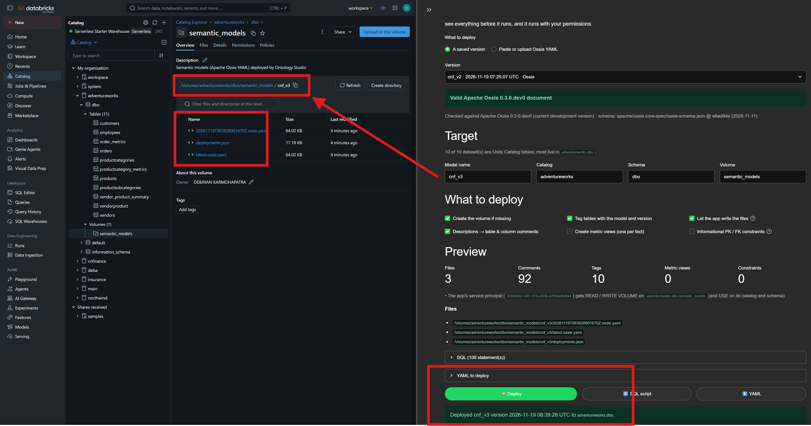
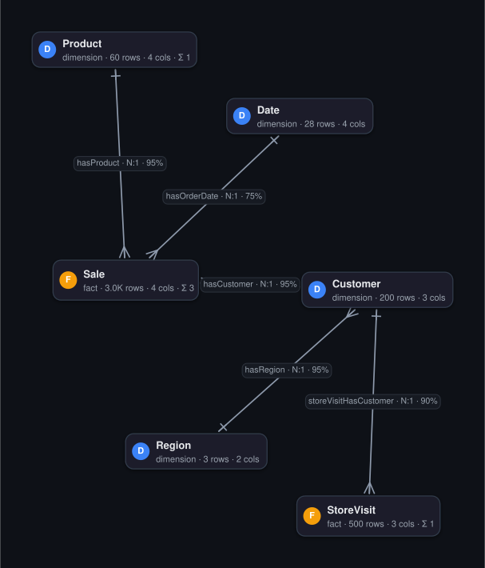
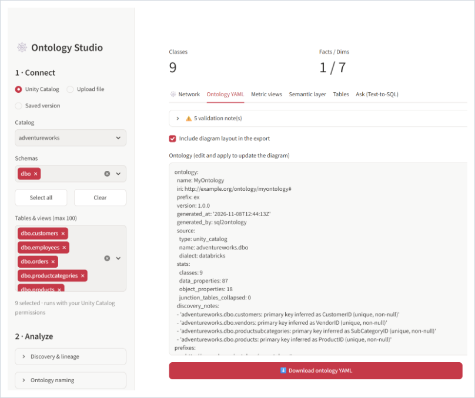
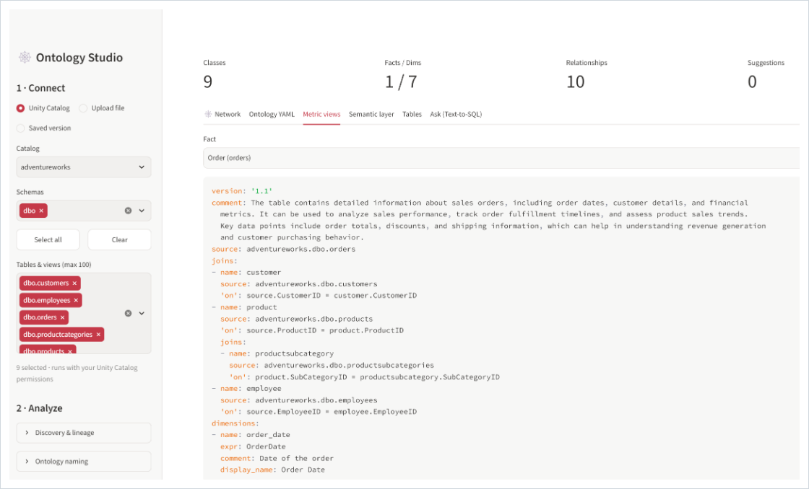
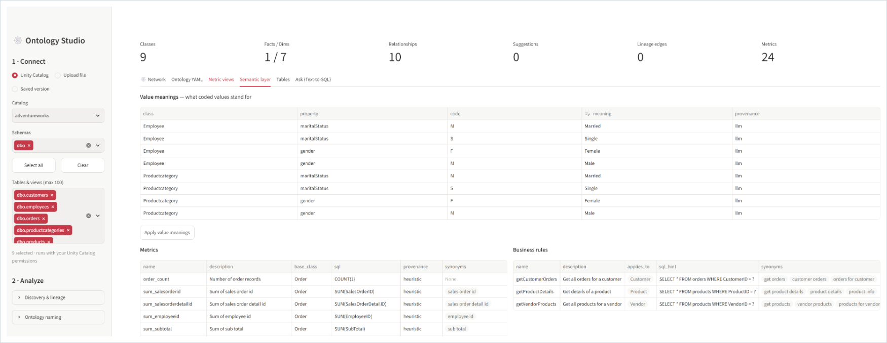
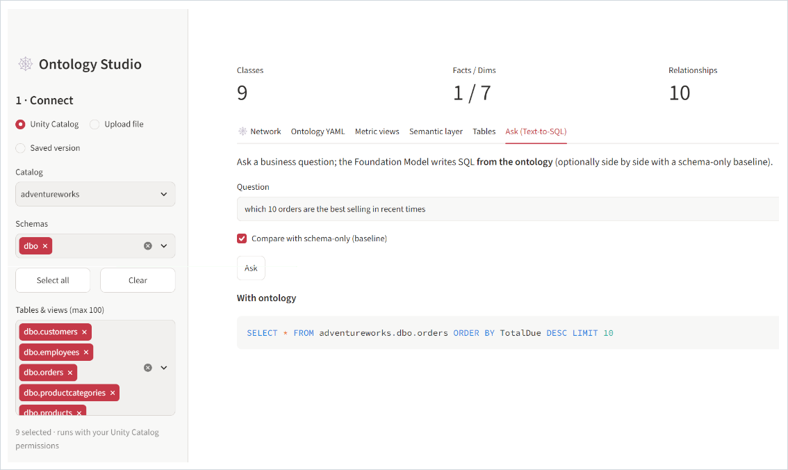
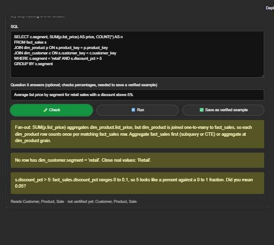
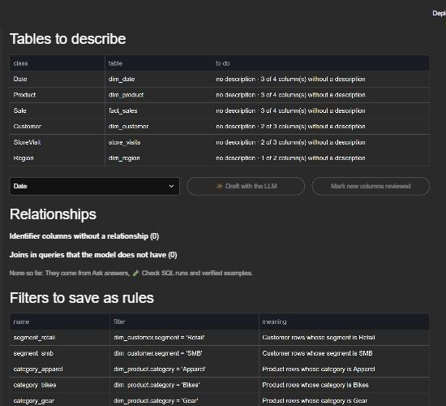
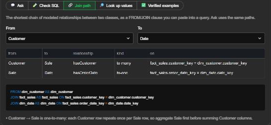
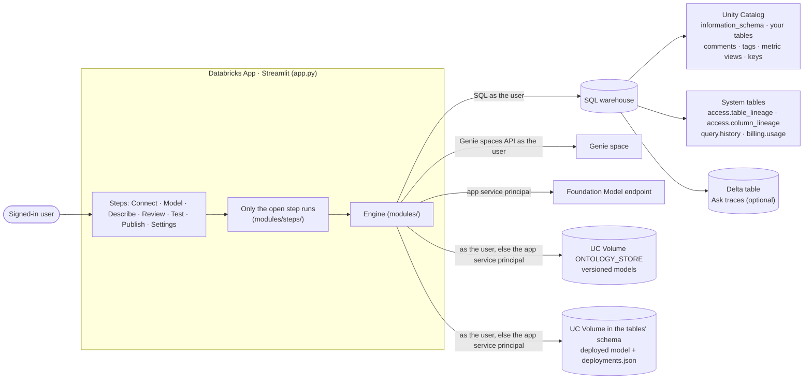

# Ontology Studio

**Turn your Unity Catalog tables into a governed, tested semantic model, and publish it where your team already works in Databricks: table and column comments, tags, metric views and a Genie space, plus a portable [Apache Ossie](https://github.com/apache/ossie) model kept next to the data.**

Ontology Studio (`sql2ontology`) is a Streamlit app that runs on [Databricks Apps](https://docs.databricks.com/aws/en/dev-tools/databricks-apps/) (including **Databricks Free Edition**). Point it at up to 100 tables and views in Unity Catalog, or at a SQLite file or a SQL script. It works out how the tables fit together, even when no foreign keys are declared. You fix what it got wrong, describe what only people know, prove the model with your own questions, and publish it.

Every SQL statement runs **as the signed-in user** (on-behalf-of-user authorization), so Unity Catalog grants, row filters and column masks still apply. The app never reads data the user couldn't already read, and nothing is copied out of Databricks.

No Databricks workspace handy? The same engine runs locally on a SQLite file or a `.sql` script, in the app or from a [command-line interface](#command-line-interface).

<p align="center">
 

</p>

## Contents

- [One journey, six steps](#one-journey-six-steps)
- [A business user's path on an existing Databricks setup](#a-business-users-path-on-an-existing-databricks-setup)
- [Features](#features): [Connect](#1-connect) · [Analyze](#2-analyze) · [Edit](#3-edit) · [Export](#4-export) · [Ask](#5-ask-test-the-ontology) · [Apache Ossie](#6-apache-ossie-validation-import-and-export) · [Govern and learn](#7-govern-and-learn-domains-certification-pages-learned-snippets) · [Traces, cost and budgets](#8-traces-feedback-cost-and-budgets)
- [Model lifecycle: versions and deployment](#model-lifecycle-versions-and-deployment) · [Genie space](#genie-space)
- [Architecture](#architecture) and [who runs what](#who-runs-what)
- [Deploy to Databricks Apps](#deploy-to-databricks-apps), [Databricks Free Edition](#databricks-free-edition) and [permissions](#permissions-users-need)
- [Configuration](#configuration) and [themes](#light-and-dark-themes)
- [Run locally](#run-locally) · [Command-line interface](#command-line-interface) · [Tests](#tests) · [Samples](#samples) · [Project layout](#project-layout)
- [Troubleshooting](#troubleshooting) · [Security and governance notes](#security-and-governance-notes) · [Change history](#change-history) · [Roadmap](#roadmap) · [License](#license)

---

## One journey, six steps

A row of buttons at the top of the page takes you through the work from left to right. Every feature lives in exactly one step, and only the step you are on runs, so each click is quick even on a large model.

| Step | Use it to | Inside |
|---|---|---|
| **1 · Connect** | get a model into the studio | **🏛️ Unity Catalog tables** (catalog, schemas, up to 100 tables or views) · **📂 Saved model** (a version from the store) · **📥 Import a file** (Apache Ossie YAML/JSON, a studio model, a SQLite database, a `.sql` script, or pasted YAML) · **✏️ Start from scratch** (the form editor). *Options*: profiling, join checks on the data, query history and lineage, AI descriptions from your documents. |
| **2 · Model** | see and fix the structure | **🕸️ Diagram** (the editable network with its inspector) · **📋 List** (tables and joins, re-scan Unity Catalog) · **🔎 Data preview** (read-only pages of table data) · **✏️ Form** (the step-by-step form editor) · **🧾 Source** (Advanced: the studio YAML) |
| **3 · Describe** | add what only people know | **📖 Dictionary** (search everything, one table in business terms) · **🧠 Meanings** (code values, glossary, rules, synonyms) · **📐 Metrics** (metrics, metric views and the guided builder) · **🏠 Domains** (domains, owners, certification) · **📊 Governance clarity** (coverage of key governance details) · **📚 Knowledge** (pages, learned snippets, experts) |
| **4 · Review** | settle everything that needs a decision | readiness line · **🚧 Blockers** · **🔗 Suggested joins** (accept or reject in bulk) · **✅ Queue** · **🧭 Worklist** · **📝 Change log** |
| **5 · Test** | prove the model answers real questions | **🎯 Test set** (golden questions, ontology vs schema-only, regressions) · **💬 Ask** (one question, plus Check SQL, Join path, Look up values, Verified examples) · **📈 Traces** |
| **6 · Publish** | keep it and put it to work | **💾 Save & versions** (the one save) · **🚀 Deploy** (one plan: YAML in a volume, comments, tags, metric views, keys, Genie space) · **⬇️ Exports** (Ossie YAML/JSON, metric views, Power BI starter kit, data dictionary) |
| **⚙️ Settings** | check how the app is set up | configuration from `app.yaml`, Ask prices and per-user token budgets, stored traces, SQL warehouse spend |

The sidebar shows the open model at a glance: its name, whether it has unsaved changes, its readiness, its test result, and a **💾 Save or publish** shortcut. **Advanced mode** in the sidebar shows expert options: the ontology IRI and prefix, naming, discovery thresholds and the studio model YAML.

### One home per job

| Job | Where |
|---|---|
| Open, import or validate a model file | **Connect → Import a file** (the only upload of model files; the report shows every finding with its line and a fix) |
| Save a version | **Publish → Save & versions** (always Apache Ossie; older studio-format versions still open) |
| Write anything to Unity Catalog or Genie | **Publish → Deploy** (comments, all tags, metric views, keys, Genie space in one previewed plan) |
| Read `system.query.history` | once, during the build: the same queries give join evidence and learned snippets (you can learn again later in **Describe → Knowledge**) |
| Decide on suggestions, certification, gaps | **Review** |
| Download | **Publish → Exports** |

## A business user's path on an existing Databricks setup

*You work in finance or operations. Your data is already in Unity Catalog (often bronze / silver / gold), you have a SQL warehouse, and your team uses or wants Genie and AI/BI dashboards.*

1. **Connect.** Pick the catalog and the schema (say `gold`), **Select all**, **Build the model**. The app reads the tables with your permissions, profiles them, finds the joins and learns from the queries people already run.
2. **Model.** Look at the diagram. Drag a wrong join to the right column, mark a table as fact or dimension.
3. **Describe.** Fill in what the app couldn't know: what *operating ratio* means, what status code `H` stands for, that "carloads" means "units". Put the tables in a *Finance* domain and name their owner. Build a metric view with the guided builder if the generated one isn't enough.
4. **Review.** Work the inbox until there are no blockers, and accept or reject the suggested joins.
5. **Test.** Add ten questions your CFO actually asks, each with the SQL that answers it, and click **Run**. Fix the ones that fail (usually a missing synonym or join) and run again.
6. **Publish.** Save version 1 with a note, open **Deploy**, keep the defaults, tick **Genie space**, check the preview and click **🚀 Deploy**.

Afterwards your team asks questions in the **Genie space**, builds AI/BI dashboards on the **metric views**, and sees the descriptions and owners in **Catalog Explorer**. When the tables change, open the saved model in **Connect**, re-scan it in **Model → List**, work the new items in **Review**, run the **Test** set again and publish version 2.

### Deploy to Databricks

<p align="center">
  
</p>

*A saved version deployed as `cnf_v3` into `adventureworks.dbo.semantic_models`: the app (right, from an earlier layout) and the result in Catalog Explorer (left).*

1. **What to deploy:** the model open in the studio or **A saved version** from the store. The YAML is validated; a model with errors can't be deployed (they are listed in **Review → Blockers**).
2. **Target:** **Model name** (the folder), **Catalog**, **Schema** and **Volume** (default `semantic_models`). Catalog and schema default to where most of the model's datasets live.
3. **Options:** create the volume if missing · descriptions → table & column comments · tags (model, version, domain, certification, owner) · metric views (one per fact plus the ones you built) · **let the app write the files** · informational PK / FK constraints · **Genie space**. Options that need Unity Catalog tables are greyed out when the model has none.
4. **Preview:** counts, the files, every SQL statement (**⬇️ SQL script**), the YAML, the Genie space definition (**⬇️ .json**) and the test-set result.
5. **🚀 Deploy** runs it with a progress bar and reports each step: files, statements and the Genie space with a link to open it.
6. **Previous deployments of this model here** lists what `deployments.json` recorded, including the Genie space, which the next deployment updates instead of creating a new one.

### Genie space

Ticking **Create or update a Genie space** turns the model into a [Genie](https://docs.databricks.com/aws/en/genie/) space through the Genie spaces API (`POST /api/2.0/genie/spaces`, [`modules/genie.py`](modules/genie.py)):

| Genie space | From the model |
|---|---|
| tables | every dataset with a `catalog.schema.table` source, its description, and the descriptions and synonyms of its columns |
| metric views | the metric views the same deployment creates |
| text instruction | the model description, business rules, glossary, code values, metrics (certified ones marked) and certified pages |
| join specs | the modeled many-to-one and one-to-one joins, with their relationship type |
| example SQL, sample questions, benchmarks | the test set (verified examples) |

The space runs on the app's SQL warehouse (`SQL_WAREHOUSE_ID`). Its id is kept in `deployments.json`, so the next deploy **updates** the same space. The call runs with your token, so the app needs the **`genie`** user authorization scope (add it next to `sql` in the app's *User authorization* settings). Without it the step fails with a clear message and the preview still offers the space definition as JSON plus a `curl` command an admin can run.

### Source types

| Source | Status | What it reads |
|---|---|---|
| Unity Catalog tables & views | available (inside Databricks Apps) | up to 100 tables and views from any catalog and schemas you can read, with your permissions |
| SQLite database or `.sql` script | available | a SQLite file, or DDL in MySQL, Postgres, T-SQL, Oracle, Snowflake, Databricks, BigQuery, Redshift, DuckDB or Teradata |
| Snowflake, PostgreSQL, Informatica CDGC | planned, not shown in the app | see [`modules/sources.py`](modules/sources.py) and the multi-source plan; a new connector is an extractor that returns the source-neutral `DatabaseSchema` ([`modules/schema_model.py`](modules/schema_model.py)) and becomes one more card in **Connect** |

A model built from a file can still be versioned and deployed: its YAML goes into the volume, and the options that change tables (comments, tags, metric views, keys, Genie) cover only datasets whose `source` is a `catalog.schema.table` name.

## Walkthrough

These screenshots come from earlier versions of the app, when these views were separate tabs; the content is the same, now reached through the steps. The network diagram uses the bundled `retail_star.db` sample.

### 1. Build and fix the model (Connect, Model)

In **Connect**, choose **🏛️ Unity Catalog tables**, a catalog, one or more schemas and up to 100 tables, then **Build the model**. **Model → Diagram** draws every table as a card (**F** amber for facts, **D** blue for dimensions, **E** grey for entities) with its row, column and measure counts, and every relationship with crow's-foot ends on the many side. Click a table to edit its role, description, synonyms, domains, certification, column roles and metrics in the inspector on the right.



**Model → Form** changes the model without touching YAML: **Model info → Datasets → Fields → Relationships → Metrics → Review & submit**. Renaming a dataset or field updates the keys and relationships that use it, and anything the form does not show (dialect variants, vendor extensions) is kept. **Model → List** lists every table with its source, row count and key, and every relationship with its join columns and confidence. **Model → Data preview** browses a selected table read-only with configurable page size and previous/next navigation. In Advanced mode, **Model → Source** shows and edits the whole model as YAML.



### 2. Describe it (Describe)

**Describe → Metrics** shows one metric view per fact, with joins nested for snowflake schemas; **➕ New metric view** builds your own (see [Guided metric view builder](#guided-metric-view-builder)). **Describe → Meanings** lists code meanings, the glossary and business rules, each with its provenance. **Describe → Governance clarity** shows a donut of recorded versus missing descriptions, owners, domains and review statuses across modeled tables and metrics. It measures documentation coverage, not governance quality or certification approval.





### 3. Test it (Test)

**Test → Test set** runs every golden question. **Test → Ask** writes SQL for one business question from the model and runs it as you; with **Compare with schema-only** ticked it also shows a baseline written from the bare table and column names. Its other modes: **Check SQL** checks any query against the model and the data, runs it with a row cap, and saves it as a verified example (a test question). **Join path** gives the chain of joins between two tables as a ready `FROM ... JOIN` clause. **Look up values** shows the real values in a column.





### 4. Publish it (Publish)

Save the model in **Publish → Save & versions** with a note. Then open **Publish → Deploy**, choose the target, tick what to create, check the preview and click **Deploy** (see [Deploy to Databricks](#deploy-to-databricks)).

---

## Features

### 1. Connect

**1 · Connect** offers four ways to start. Models come into the studio only here.

- **Unity Catalog** (on Databricks): pick a catalog, one or more of its schemas, and up to 100 tables and views from those schemas. Declared foreign keys that point into another schema or catalog are resolved too.
- **Upload a file**: a SQLite database (`.db`, `.sqlite`, `.sqlite3`) or a SQL script (`.sql`, `.ddl`, `.txt`). With the dialect on **auto**, a script first runs in an in-memory SQLite database, so dumps with `INSERT`s get profiled too. Otherwise, or if that fails, the DDL is parsed with [sqlglot](https://github.com/tobymao/sqlglot) in the dialect you pick: MySQL, Postgres, T-SQL, Oracle, Snowflake, Databricks, BigQuery, Redshift, DuckDB or Teradata.
- **Import an Apache Ossie model** (*📥 Import a file*): an [Apache Ossie](https://github.com/apache/ossie) semantic model (`.yaml`, `.yml` or `.json`). It is validated first (see [Apache Ossie](#6-apache-ossie-validation-import-and-export)) and opens when it passes. A studio model (`.ontology.yaml`) opens as is.
- **📂 Saved model**: open any version saved to the Volume store (needs [`ONTOLOGY_STORE`](#configuration)).
- **Paste** (*📥 Import a file*, with no file picked): an Ossie model or a studio model YAML.
- **✏️ Start from scratch**: a blank model in the form editor.

### 2. Analyze

| Step | What it does |
|---|---|
| **Objects** | Reads `information_schema` in each catalog: tables, views, columns, comments, and primary key, unique and foreign key constraints. Declared foreign keys resolve across schemas and catalogs. |
| **Profiling** | Row counts, distinct counts (`approx_count_distinct` on Unity Catalog), non-null counts, the 5 most common values per column, and the distinct values of low-cardinality text columns (enumerations). On Unity Catalog it profiles 8 tables in parallel and skips complex types (`ARRAY`, `MAP`, `STRUCT`, `VARIANT`, …). The rules below come from [NVIDIA Auto Ontology](https://github.com/NVIDIA/auto-ontology). |
| **Primary keys** | Uses declared keys. Where there are none, it infers one from a unique, non-null column with a key-like name (`*_id`, `*_key`, `*_sk`, `*_code`, …) or a name that starts with the table's entity. Needs profiling, which is on by default. |
| **Relationships** | Scores every candidate join from five signals (below). Strong joins are accepted; the rest become suggestions for you to review. |
| **Lineage** | Reads `system.access.table_lineage` and `system.access.column_lineage` (last 180 days by default). Upstream and downstream tables outside your selection appear as external nodes. |
| **Semantics** | Classifies each class as **fact**, **dimension** or **entity**, and each column as **key**, **time**, **measure** or **dimension**. Measures get a default aggregation: `AVG` for prices, rates and ratios, otherwise `SUM`. Every fact gets base metrics: a row count plus one metric per measure. |
| **LLM enrichment** (optional) | Fills in descriptions, synonyms, code meanings, business rules and metrics, grounded in documents you upload (below). |

#### What profiling keeps, skips and infers

| Rule | What happens |
|---|---|
| **Personal data** | Columns whose names mark personal data are tagged `pii: <category>` (`email_address`, `phone_number`, `government_id`, `date_of_birth`, `payment_card`, `banking`, `credential`, …). Names, addresses, ids, age, gender and salary count only in a table of people (`customers`, `employees`, `users`, also `dim_customer` or `silver_customers`). Their values are never read: no samples, no list of values, no min/max, only counts. A model opened from a file or edited by hand gets the same treatment, so personal values never reach the LLM, an Ossie export or a saved version. The rules read names only: a column they cannot place, such as `contact_name` or `employee_name`, keeps its values until you tag it (`pii: person_name` in the YAML), and `pii: false` stops the tagging for a column. |
| **Text dates** | A text column whose values all read as one date notation gets `date_format` (`YYYY-MM-DD`, `MM/DD/YYYY`, `YYYYMMDD`, `YYYY-MM`, …). `13/07/2011` settles day-first; when every value reads both ways, nothing is claimed. Ask is told to write literals in that notation and to parse the column with it. |
| **Samples** | The 5 most common values (of a 200-row sample on Unity Catalog), keeping numbers, dates and flags, and text of 30 characters or less (longer text is prose, not a useful example). |
| **Key columns to other tables** | A foreign key to a table outside the model stays a column, with `references: table.column` and the key role, instead of vanishing. |
| **Circuit breaker** | After 3 tables in a row time out or cannot reach the SQL warehouse, profiling stops and says how many tables it skipped; overlap checks stop the same way. |
| **Descriptions** | A description that only repeats the name (`customer_id`: "Customer ID") counts as missing in the worklist and readiness, and LLM enrichment may replace it when it was copied from a database comment. What a person wrote is never replaced. |

#### How relationships are found

Unity Catalog constraints are informational and often missing, so each candidate join collects evidence and gets one confidence score between 0 and 1:

| Signal | Effect on the score |
|---|---|
| Declared foreign key | Taken as given (1.0). |
| Naming | Same name as the target's key, e.g. `fact_sales.customer_key = dim_customer.customer_key` (0.60). A column that names the entity, e.g. `cust_id → customers` (0.55). A column that ends with the key's name (0.40). |
| Same key | Two tables keyed by the same specific column, e.g. `customer_scores.customer_id` and `customers.customer_id`, hold one row per customer each: a one-to-one join to the table with more rows (0.60). Generic key names (`id`, `key`, `code`, …) never count, and copies of one table (`stg_customers`, `customers_2024`) are left apart. |
| Type check | −0.30 when one side is numeric and the other is text. |
| Value overlap | A sampled `LEFT JOIN` for the top 80 candidates: what share of up to 5,000 distinct child values exist in the parent key. ≥ 98% adds 0.35, ≥ 90% adds 0.25, ≥ 70% adds 0.10, anything lower subtracts 0.50. For a same-key join whose key values are all shorter than 3 characters (1, 2, 3 sit inside any key), are labels, or are withheld as personal data and number under 100, a high overlap adds nothing, so the join stays a suggestion. |
| Query history | Equality joins that people actually ran, parsed with sqlglot from finished `SELECT`s in `system.query.history` (last 90 days, up to 3,000 statements). Raises the score to at least 0.45, plus up to 0.30 more the more often the join appears. |

The best target per child column wins. Joins at or above the threshold (0.75 by default, adjustable in Connect → Options in Advanced mode) become relationships. Joins between 0.30 and the threshold become **suggestions**, with their evidence attached, which you accept or reject. Nothing is added silently.

If the query text in `system.query.history` is redacted for the user, the app skips that signal and says so.

#### LLM enrichment, grounded in your documents

On Databricks, tick the LLM option and upload a data dictionary, KPI definitions or code lists (`.md`, `.txt`, `.csv`, `.json`, `.yaml`). The Foundation Model endpoint then adds:

- descriptions and synonyms for classes and columns,
- **value meanings** for coded columns (`line_cd: M → Mountain`),
- **business rules** with SQL hints (*fiscal year starts 1 July*),
- **metrics** with SQL expressions (*AOV = SUM(subtotal) / COUNT(order)*).

Guardrails:

- The model is told to use only the classes and columns it was given.
- It only fills **empty** descriptions and code meanings. It never overwrites what came from the schema.
- Rules and metrics that point at unknown classes are dropped.
- Everything it adds is tagged `provenance: docs/<file>` when a document supports it, or `provenance: llm` when it doesn't.

Classes go to the model in batches of 25, with up to 60,000 characters of your documents.

### 3. Edit

**The network diagram** (D3.js, bundled with the app, no CDN):

- **Nodes** are cards with a role badge (**F** fact, **D** dimension, **E** entity, **B** bridge) and their row, column and measure counts. Dashed outlines are external tables that only appear in lineage. Hover a card for its table, description and columns (🔑 keys, 🕒 time, Σ measures).
- **Edges:** relationships are labelled with name, cardinality and confidence, with crow's-foot ends (many-to-one, one-to-one, many-to-many). Dashed orange lines are suggestions. Animated dotted green lines are lineage. Parallel relationships curve apart and self-references loop.
- **Toolbar:**
  - **＋ Connect:** drag from the class that holds the key to the class it points to (or click both). The app guesses the join columns; check them in the inspector.
  - **Repoint target / Repoint source:** select a relationship, then click its new class.
  - **Delete** the selected relationship. **✓ Accept** or **✕ Reject** the selected suggestion.
  - **Layouts:** force-directed, layered (facts on the left, dimensions to the right) and radial (facts in the centre). **Re-layout**, **Fit**, zoom, full screen, **Find class…**, a minimap, and show/hide toggles for relationships, suggestions, lineage, labels and the minimap.
  - **SVG / PNG** download of the diagram.
  - Keyboard: `C` connect, `Del` delete, `Esc` cancel, `F` fit, `L` re-layout, `/` find. Double-click a class to focus on it and its neighbours.
- **Drag nodes** to arrange them. Positions are saved in the ontology (`layout:`), so the diagram looks the same next time.

**The inspector** (right panel) edits whatever you click:

- **Class:** rename it, set its role (fact, dimension, entity or bridge), description, synonyms and a reviewer note; set each column's role, aggregation and description; add, replace or delete metrics. A new metric is run read-only on the data first and is not saved if the database rejects it. Changing the name or description of a certified class puts it back to draft.
- **Relationship:** name, cardinality, the join columns on both sides, a **role** (billing vs delivery) and description, and whether it is the **default** join between its two classes, or delete it.
- **Suggestion:** confidence and evidence, then accept or reject.
- **Lineage edge:** event count, when it was last seen, and the column mappings.
- **Nothing selected:** add a relationship from a form, or re-run the classification. Suggested joins are settled one by one on the diagram or in bulk in **Review → Suggested joins**.

**Other views:**

- **Model → Source** (Advanced mode): edit the YAML and click **Apply YAML edits** to redraw the diagram; a pasted Ossie model is validated and opened. Validation notes flag relationships that point at missing classes, inverses that don't point back, classes without an identifier, and coded values that still have no meaning.
- **Describe → Meanings:** search the model (classes, columns, metrics, rules, pages, glossary, stored values) and open a **Term card** with a class's definition, columns and samples, unmapped columns, joins, metrics and pages; edit value meanings and the glossary; review metrics, business rules and the synonyms index.
- **Model → List:** classes (with unmapped and new columns) and relationships as plain tables, and **🔄 Re-scan the tables in Unity Catalog** (below).
- **Model → Data preview:** select a modeled source table and browse its rows in read-only pages. Choose 10–500 rows per page and use **← Previous** / **Next →** to navigate. Available for live Unity Catalog and SQLite sources.
- **Describe → Governance clarity:** compare recorded and missing business descriptions, owners, domains and review statuses across modeled tables and metrics. The donut is a coverage indicator, not an assessment of governance quality.

#### Modeling assistant: re-scan, worklist and relationship review

- **Re-scan** (Model → List, models built from Unity Catalog): reads the model's tables again and lists new, dropped and retyped columns and tables that are gone. **Apply** adds the new columns, removes the dropped ones, updates types, row counts and profiles, and keeps descriptions, synonyms, roles, certification, joins and metrics; it names relationships that used a dropped column. **List tables** finds tables in the same schemas that the model does not have, with filters such as `SALES_*, HR.EMP*, !*_LOG`; **Add selected** reads them, adds them as classes and proposes their joins with the model (declared keys first, then name and value-overlap evidence) for review in the diagram and in Review.
- **🧭 Worklist** (Review): tables with new columns, no description, a description that does not say what one row is, or undescribed columns, most urgent first. **✨ Draft with the LLM** fills only what is empty for one table, with descriptions that state the grain ("One row per order line"); drafts stay drafts until a person certifies them.
- **Relationship review** (same page): pairs of classes joined more than once, where you pick the **default** join; identifier columns with no relationship and the classes their values could point at (with a value check); and joins people run in Ask, 🧪 Check SQL or verified examples that the model does not have, each one click from becoming a relationship.
- **Filters to save as rules**: named filters from short value lists (`dim_customer.segment = 'Retail'`), tested on the data before they are saved.
- **🧹 Model checks** in the review queue: tables that do not say what one row is, multi-role joins without a default, unlinked identifier columns, measure columns without a metric, and metrics whose SQL fails the checker (including metrics that read a table no modeled join reaches).
- **Change log** (Review): every edit with who made it and when, saved with each version.

Join paths, Ask and the SQL checker use the default join of a pair; the checker notes when a query uses another role.



### 4. Export

**Ontology YAML.** Readable and diff-able, so it can live in git. Trimmed from [`samples/retail_star.ontology.yaml`](samples/retail_star.ontology.yaml):

```yaml
classes:
  Customer:
    source_table: dim_customer
    identifier: [customerKey]
    identifier_inferred: true
    role: dimension
object_properties:
  hasRegion:
    domain: Customer
    range: Region
    cardinality: many-to-one
    inverse: hasCustomers
    join:
      from: [dim_customer.region_code]
      to: [dim_region.region_code]
    confidence: 0.95
    provenance: discovered
```

The file also carries `value_meanings`, `rules`, `metrics`, `suggested_relationships`, `lineage`, a `synonyms_index` (business term → class, column, metric or rule), the diagram `layout`, and standard RDF/OWL/XSD prefixes.

**Databricks metric views** (YAML spec 1.1), one per fact:

- many-to-one joins from the fact, nested for snowflake schemas (up to 3 levels deep), with `rely: {at_most_one_match: true}` when a join lands on the joined table's declared key (never on an inferred one),
- `fields` (the current name for `dimensions`, which Databricks still accepts) from the fact and from every class it joins to,
- measures from the ontology's metrics, plus an aggregate for each measure column that has no metric yet. Metrics whose SQL doesn't aggregate are left out (the spec requires measures to aggregate) and listed in the view's comment.

Names are unique across fields and measures (ignoring case), display names are capped at 255 characters and synonyms at 10, as the [metric view YAML reference](https://docs.databricks.com/aws/en/uc-semantics/metric-views/yaml-reference) requires.

Trimmed from [`samples/metric_views/sale_metrics.yaml`](samples/metric_views/sale_metrics.yaml):

```yaml
version: '1.1'
source: fact_sales
joins:
- name: customer
  source: dim_customer
  'on': source.customer_key = customer.customer_key
  joins:
  - name: region
    source: dim_region
    'on': customer.region_code = region.region_code
fields:
- name: region_name
  expr: customer.region.region_name
  display_name: Region Name
measures:
- name: sum_net_amount
  expr: SUM(net_amount)
  display_name: Sum Net Amount
```

**Describe → Metrics** shows every view. **Publish → Exports** downloads a zip with every view and its `CREATE OR REPLACE VIEW … WITH METRICS LANGUAGE YAML` statement, and **Publish → Deploy** (tick *metric views*) creates them all in Unity Catalog as you, so you need `CREATE TABLE` on the target schema. Generated views are named `<catalog>.<schema>.<fact>_metrics` in the deploy target; views you build keep the name you gave them.

#### Guided metric view builder

**➕ New metric view** (Describe → Metrics) builds a metric view step by step. Every step is pre-filled and each suggestion says why it is there:

| Step | What you get |
|---|---|
| ① Start from | Fact tables first, with how many metrics the model has for each. |
| ② Joins | The many-to-one relationships of that table (key joins get `rely: at_most_one_match`). Untick one and its fields and measures leave the lists. |
| ③ Fields | The generated view's fields, time columns first, with profiled values (`3 values: Store, Web, Catalog`) and how often colleagues' queries use the column. Month and year versions of date fields are offered unticked. |
| ④ Measures | The model's metrics, ticked. Offered unticked: a row count, a distinct count per joined table, and the aggregates your team actually runs (learned query snippets, ranked by authority). Metrics a metric view can't hold (window functions, tables the view doesn't join) stay unticked with the reason. **Quick add** makes `SUM` / `AVG` / `MIN` / `MAX` / `COUNT DISTINCT` of a column, or a ratio of two measures (`MEASURE(a) / NULLIF(MEASURE(b), 0)`), without writing SQL; you can also type your own rows. |
| ⑤ Filter | Conditions your team often filters on, or **Keep rows where** a column is one of its profiled values. |
| ⑥ Name, check and save | Live checks (unique names, aggregating measures, joins in place, no tables outside the view) and the YAML. **💾 Add to the model** lists the view with a ★ and saves it with the model (it travels in the Apache Ossie export and versions, and **Publish → Deploy** creates it); you can also download it. |

**Apache Ossie.** **Publish → Exports** exports the model as an Ossie `0.3.0.dev0` document (YAML or JSON) and validates it before you download it. See [below](#6-apache-ossie-validation-import-and-export).

**Versions.** With `ONTOLOGY_STORE` set, **💾 Save as new version** (Publish → Save & versions) saves the model as Ossie YAML, the one save in the app. See [Model lifecycle](#model-lifecycle-versions-and-deployment).

### 5. Ask: test the ontology

Type a business question. The Foundation Model writes SQL **from the ontology** (classes, synonyms, joins, code meanings, rules and metrics). With **Compare with schema-only** on, it also writes a **baseline** query from the bare table and column names, so you can see both SQL statements and both result sets side by side.

How Ask works out an answer:

1. **Coverage check** (*Coverage check first*, on by default). The model pulls 1 to 5 phrases out of the question, and each is looked up in the model: a class, column, metric, rule or page (**covered**), a glossary abbreviation that leads to one, a value stored in the data such as a product or a country (**covered by a stored value**, found in the profiled values or with one small query), a **weak** match, or **not covered**. When nothing is covered, Ask writes no SQL and says what data would be needed. When part is missing, it says so above the answer and tells the model not to substitute a similar measure.
2. **Focus.** It matches the question's words against class, column and metric names, labels, synonyms and page titles, and puts the best matches at the top of the prompt: tables, metrics with their SQL (certified first), the **join path** between the matched classes as a `FROM ... JOIN` clause with fan-out notes, **verified examples** for similar questions, the **glossary**, and the exact stored values to use as literals.
3. **Plan and write.** The model answers with JSON: a short reasoning, the assumptions it made, and one query. The prompt tells it to reuse metric and snippet definitions instead of inventing formulas, follow the join path hop by hop, aggregate detail rows before joining them to a parent, respect the grain ("for each month in 1997" means one row per month, filtered to 1997, in order), return readable labels, and use the dialect's date functions.
4. **Check.** The query must parse and be a single read-only `SELECT` / `WITH`, and then goes through the **SQL checker** (below). Its errors go back to the model before anything runs.
5. **Run and self-correct.** It runs on Unity Catalog as you, or on the uploaded SQLite file. If it fails, the error goes back to the model to fix its own query (up to three attempts in total); an empty result, or a query the checker warns about, gets one more try. A query the model keeps on purpose is not run twice. **How it answered** shows the reasoning, assumptions, every corrected attempt and the checker's findings; warnings stay on screen next to the answer.

Profiled sample values (Decimal, dates, bytes from Unity Catalog) are converted before they go into the prompt. The Ask mode needs the model endpoint, so it works on Databricks only; the other modes below work anywhere.

#### Check SQL, join paths, values and verified examples

The SQL checker (`modules/sqlcheck.py`) reads a query without returning rows and reports:

- anything that is not a single read-only `SELECT`, reads a table outside the model, or calls a function that reaches outside the query (`read_files`, `http_request`, `ai_query` …),
- unknown tables or columns, with the model's name for them ("did you mean"), including Unity Catalog `catalog.schema.table` names,
- joins the model does not know, joins it rejected or only suggests, and joins on the wrong columns when the model joins those tables differently (with a value-containment probe for unknown joins),
- double counting: `SUM` / `AVG` / `COUNT` over the one side of a one-to-many join, or over a table whose sibling branch fans out through a shared parent,
- a many-side column selected next to a `GROUP BY` on its parent, a `GROUP BY` on a primary key, integer division in SQLite and similar dialects, and placeholder queries (`WHERE 1 = 0`),
- with live data: text values that match no row, with the closest real values (`'retail'` → `'Retail'`); thresholds on the wrong scale (`discount_pct > 5` on a 0 to 1 column, or "below 0.18%" written as `0.18`); a dry run,
- which classes and metrics the query relies on, and which of them are not certified yet.

Probes are small read-only queries with the viewer's permissions, capped per check. Ask's other modes (Test → Ask) use the same engine:

| Mode | What it does |
|---|---|
| 🧪 Check SQL | Check any query, run it with a 200-row cap (traced in Test → Traces), save it as a verified example |
| 🔗 Join path | The shortest chain of modeled joins between two classes, its `FROM ... JOIN` clause, fan-out and shared-parent notes, other roles for the same hop |
| 🔎 Look up values | Real values in a column: matches for a word with row counts, close spellings, or the most common values |
| ✅ Verified examples | The confirmed question and SQL pairs, which are also the test set: open one in Check SQL or delete it |

A 👍 on an Ask answer also keeps it as a verified example. Verified examples and the **glossary** (abbreviations and jargon, edited in Describe → Meanings) are saved with the model: in Ossie, the example questions go to the model's `ai_context.examples` and the rest travels in the `ONTOLOGY_STUDIO` extension. A **readiness** line (sidebar and Review) says whether SQL can run on the model's data, how much is described, joined and certified, and what to do next.



These checks, the coverage check, join paths and the modeling rules in the prompt are adapted from [auto-ontology-mcp](https://github.com/gogoymh/auto-ontology-mcp), which ports [NVIDIA Auto Ontology](https://github.com/NVIDIA/auto-ontology); both are Apache-2.0 (see [NOTICE](NOTICE)).

### 6. Apache Ossie: validation, import and export

[Apache Ossie](https://github.com/apache/ossie) (incubating, formerly Open Semantic Interchange) is a vendor-neutral YAML/JSON format for one semantic model: datasets, relationships, fields and metrics, with per-dialect SQL and AI context.

**Validation.** In **Connect → 📥 Import a file**, upload a file or paste it. It is checked against the official JSON Schema of the version it declares, bundled from apache/ossie in [`modules/ossie/schemas/`](modules/ossie/schemas/):

| Declared `version` | Status | Notes |
|---|---|---|
| `0.3.0.dev0` | current development version | `nonportable_extensions` with object `data` |
| `0.2.0.dev0` | former development label | `custom_extensions` with JSON-string `data`; passes with a warning |
| `0.1.1` | first release (2025-12-11) | models wrapped in a `semantic_model` list; passes with a warning |

Tick **Require the current spec version** to treat anything older than `0.3.0.dev0` as an error. After the schema, the semantic checks follow the reference validator (`validation/validate.py` in apache/ossie):

| Check | Severity |
|---|---|
| YAML/JSON parses as one document, no duplicate keys, a mapping at the root | error |
| JSON Schema: required properties, types, `DataType` values, expression shape, no unknown keys (with "did you mean" hints and migration hints such as `custom_extensions` → `nonportable_extensions`) | error |
| Extension `data` is JSON: no dates, NaN or non-string keys; unquoted YAML scalars that readers disagree on | error / warning |
| Unique dataset, field, metric and relationship names; fields and dataset-scoped metrics share one namespace | error |
| Relationships name declared datasets; keys and join columns name declared fields | error (warning for older versions) |
| `from_columns` and `to_columns` have the same length | error |
| Dataset-scoped metrics use their own fields unqualified, or `source.column` | error |
| Every SQL-family expression parses as one expression (sqlglot) | error |
| Model metrics use `dataset.field`; `to_columns` covers a key; field shadowing; dialect variants agree; no `NOW()` / `RANDOM()` | warning |
| Modelling lints: aggregates in fields, metrics without an aggregate, duplicate dialects or relationships, case-only name clashes, fieldless or isolated datasets, ambiguous synonyms | warning / note |

As in the reference validator, the semantic checks run once the schema errors are fixed. The report lists each finding with its path, line number and a fix, and downloads as Markdown. Older documents get an **Upgrade to 0.3.0.dev0** button that rewrites them in the current shape (unwraps `semantic_model`, renames `custom_extensions`, turns JSON-string data into objects, declares fields that keys name) and re-validates the result.

**Import.** **Open** turns datasets into classes, fields into properties (`datatype` → XSD range, `is_time` → time role, computed expressions kept), relationships into many-to-one joins, and metrics into metrics whose SQL is rewritten to source columns, so metric views and Ask work on imported models. When every dataset source is a `catalog.schema.table` name, Ask and metric view deploys run against Unity Catalog.

**Export.** **Publish → Exports** exports any model as `0.3.0.dev0`. Join columns become declared fields, many-to-many relationships become their junction dataset plus two relationships, and code meanings go into `ai_context`. Studio-only details (roles, aggregations, rules, provenance, optionally the layout) travel in `nonportable_extensions` under `ONTOLOGY_STUDIO`, so a round trip through Ossie loses nothing. The export is validated before you download it.

### 7. Govern and learn: domains, certification, pages, learned snippets

These features follow the ideas in Databricks' Genie ontology (a curated, *modeled* head plus a *learned* tail), built from what a Databricks App can reach: Unity Catalog, system tables and the SQL warehouse.

**🏠 Domains (ontology home).** A domain is a tag for a logical group of assets: Sales, Finance, Supply chain, a region. Subdomains have a parent (`Supply chain/Logistics`), and a table can live in several domains. **✨ Suggest domains** guesses them from table names and joins (a fact takes the domain of the dimensions it references); metrics and rules inherit their base class's domains. **Describe → Domains** shows a domain map with the tables, metrics, pages and snippets of each domain, and lets you assign tables, certify them and set owners. **Publish → Deploy** writes them as `ontology_domain`, `ontology_certification` and `ontology_owner` tags on the source tables (`ALTER TABLE … SET TAGS`, needs `APPLY TAG`) together with the model and version tags; building from Unity Catalog reads them back, so domains tagged once show up in every new model.

**Governed metrics.** Every metric, rule, page and table has a status: `draft`, `certified` or `deprecated`, with an owner and who certified it when. Ask marks certified definitions `certified: true` so the model prefers them, and never sends deprecated ones. Editing a certified metric sets it back to draft.

**📚 Pages.** A page is the qualitative counterpart of a metric: a governed Markdown wiki page that explains a concept (net vs gross revenue, what "late" means). Pages have domains, an owner, a status, synonyms and links to classes, metrics and rules. Certified pages go into the Ask prompt first. Download them all as a zip of Markdown files with front matter.

**🧠 Learned snippets.** The studio parses the SQL people actually run (sqlglot) into snippets:

| Kind | Example |
|---|---|
| join | `OrderDetail.ProductID = Product.ProductID` |
| filter | `Order.ShippedDate > Order.RequiredDate` (each `WHERE` condition) |
| expression | `SUM(OrderDetail.UnitPrice * OrderDetail.Quantity * (1 - OrderDetail.Discount))` named `net_revenue` |

Sources: `system.query.history` for the ontology's tables (with `executed_by` and `query_source`, so it knows whether a query came from a dashboard, Genie space, notebook, job, alert or the SQL editor), an uploaded `.sql` / `.csv` query log, and Ask answers that got a 👍. Each snippet gets an **authority score** from 0 to 1, a transparent weighted blend shown for every snippet:

| Signal | Weight | Meaning |
|---|---|---|
| popularity | 0.30 | how often it is used (log scale) |
| reach | 0.20 | how many different people use it |
| author | 0.15 | how authoritative its authors are: volume of work, how much of it is shared, how often others reuse their snippets, plus a +0.3 boost for **trusted authors** you name |
| sharing | 0.15 | share of uses in shared assets (dashboards, Genie spaces, jobs, alerts) |
| documented | 0.10 | someone explained it in a SQL comment |
| recency | 0.10 | halves every 90 days |

Snippets with authority ≥ 0.35 (or promoted ones) go into the Ask prompt as examples of how colleagues query the data. **🧑‍🏫 Experts** ranks people per table by authority-weighted use, so you know whom to ask. Try it with **Sample: Northwind query log** ([`samples/query_logs/northwind_query_log.csv`](samples/query_logs/northwind_query_log.csv), 60 queries by five people) on a Northwind SQLite database.

**✅ Review queue.** The studio proposes what an admin should promote, certify or explain, highest priority first:

| Item | Fires when | Actions |
|---|---|---|
| 🔥 Popular snippet | authority ≥ 0.5 and not yet a relationship, metric or rule | promote to metric / rule / relationship, draft a page, dismiss |
| ⚖️ Conflicting definitions | one name with several formulas (`net_revenue` vs `revenue`) | draft a page that settles it, certify one metric (the others are deprecated) |
| 📝 Needs certification | a draft metric, rule or page that Ask uses, or that came from the LLM, a snippet or a review | certify with an owner, deprecate |
| 👎 Feedback hotspot | 👎 or failed Ask requests, clustered by domain and the tables their SQL touched | draft a page |
| 🕳️ Knowledge gap | words asked about twice or more that match nothing in the ontology | draft a page |
| 🗂️ No domain | tables without a domain (domain-scoped questions skip them) | suggest domains |

Drafted pages use the Foundation Model when **Draft pages with the LLM** is on, otherwise a template filled with the evidence. They arrive as drafts, so they come back to the queue for certification.

### 8. Traces, feedback, cost and budgets

**Ask** has a **domain scope**: only that domain's tables (plus the tables they join to), metrics, rules, pages and snippets go to the model, and Ask shows how much smaller the prompt is. Every request is traced; rate answers with 👍 / 👎 and a note.

**Test → 📈 Traces** lists the traces with filters (user, domain, status, feedback), and opens any request step by step: scope, the assets in the prompt, model call (tokens, time), warehouse run (rows, time), result. It charts model cost per user and tokens per domain. **⚙️ Settings** holds the prices per million input and output tokens, a **daily token budget per user** (Ask refuses new questions once a user has spent it), **Load stored traces**, and **Load warehouse cost**, which reads `system.billing.usage` and `system.billing.list_prices` for the app's SQL warehouse and splits the spend per user by their share of query time in `system.query.history`.

Traces live in the session. Set `TELEMETRY_TABLE` to a `catalog.schema.table` and every trace is also written to that Delta table as the user (created if missing), so traces survive restarts, budgets hold across sessions and you can build dashboards on them.

#### Test set

**Test → 🎯 Test set** holds the model's golden questions: each a business question plus the SQL a person confirmed (the same list as the verified examples, so a 👍 in Ask or a save from Check SQL adds to it). **▶ Run** asks every question again through Ask with that question's own SQL held back, runs the generated SQL and the expected SQL on the data, and compares the results (same rows and values, ignoring column names and row order). With **Also run schema-only** it shows how many the bare tables would get right, which is the model's value in one number. The last ten runs are saved with the model; questions that passed before and fail now are flagged as regressions, the sidebar shows the result, and **Publish → Deploy** warns when the set has not been run or does not pass. The questions also become the Genie space's sample questions, example SQL and benchmarks.

**Not built, because a Databricks App can't do it:** Genie Search (the managed enterprise search index over Gmail, SharePoint, Confluence and Google Drive), learning from Power BI / Tableau / SharePoint documents, the Workday connector and org chart, Unity AI Gateway tool policies and hard budget caps for Genie itself, and traces of Genie's own agents. The studio's versions cover its own Ask requests and the data in Unity Catalog and system tables.

### 9. Dictionary and the Power BI starter kit

**Describe → 📖 Dictionary** shows each table in business terms. Search finds tables, columns, measures and pages by business word ("country", "freight", "ship date"). The overview lists every table with its role, rows, grain, last change and owner. Opening a table shows:

- **The table:** source (`catalog.schema.table`, table or view), grain ("one row per order and product combination"), role, rows, size and last change (from `DESCRIBE DETAIL` and `information_schema.tables`), owner, domains, certification and lineage. Warnings cover multi-column keys, missing or inferred keys, views, self-referencing hierarchies and always-empty columns.
- **Columns:** business name, description, kind (key, foreign key, date, measure source, attribute), source column and type, the column it references, synonyms, and the profile: null %, distinct count, min/max and samples. Notes flag foreign keys with blanks, 0/1 flags, codes that look like amounts, high-cardinality text, money stored as floating point and date/time columns to split.
- **Relationships:** the joins of the table, and a **Check now** button that counts rows with an empty or unmatched key.
- **Usage and docs:** how people query the table (learned snippets by authority), who to ask, pages, code values and business rules.

**Publish → Exports → Power BI starter kit** keeps everything a Power BI developer needs, as files: the data dictionary in Markdown, tables/columns/relationships/measures CSVs with Power BI data types, Summarize by, Hide, format strings and data categories, `measures.dax` (the metrics translated from SQL to DAX: `SUM`/`SUMX`, `RELATED` across *:1 joins, `DIVIDE`, `COUNTROWS`, `DISTINCTCOUNT`, `SWITCH`), a Date table, one Power Query (`.pq`) script per table and a storage-mode recommendation per table ([`modules/powerbi.py`](modules/powerbi.py)). Profiling (row counts, nulls, distinct values, min/max) needs the build's profiling option.

---

---

## Model lifecycle: versions and deployment

### Versioned store (`ONTOLOGY_STORE`)

Set `ONTOLOGY_STORE` in [`app.yaml`](app.yaml) to a Volume path such as `/Volumes/main/ontology/store` (the default in this repository). Create the volume once and give the app's service principal access:

```sql
CREATE SCHEMA IF NOT EXISTS main.ontology;
CREATE VOLUME IF NOT EXISTS main.ontology.store;
GRANT USE CATALOG ON CATALOG main TO `<app service principal application id>`;
GRANT USE SCHEMA ON SCHEMA main.ontology TO `<app service principal application id>`;
GRANT READ VOLUME, WRITE VOLUME ON VOLUME main.ontology.store TO `<app service principal application id>`;
```

(The application id is `service_principal_client_id` in `databricks apps get <app> -o json`.) Every save is a new file; nothing is overwritten:

```
<ONTOLOGY_STORE>/<model>/versions/<UTC stamp>.ossie.yaml      Apache Ossie model
<ONTOLOGY_STORE>/<model>/versions/<UTC stamp>.ontology.yaml   studio model (saved by earlier versions; still opens)
<ONTOLOGY_STORE>/<model>/latest.ossie.yaml                    newest Ossie version
<ONTOLOGY_STORE>/<model>/history.jsonl                        one JSON line per save
```

`<model>` is the model name in lower case with anything other than letters, digits, `_` and `-` turned into `-`. The UTC stamp has microseconds (`20261119T064934025539Z`), so two saves never clash. Each line of `history.jsonl` records:

| Key | Meaning |
|---|---|
| `model`, `version`, `path`, `kind` | folder, stamp, file path, `ossie` or `ontology` |
| `saved_at`, `saved_by`, `note` | UTC time, the signed-in user's email, the "what changed" note |
| `sha256`, `bytes` | content hash and size, to spot identical versions |
| `spec_version`, `errors`, `warnings` | Ossie version and validation counts at save time |
| `restored_from` | for a restore, the path of the version it copied |

There is one save: **Publish → Save & versions → 💾 Save as new version** writes the open model as Apache Ossie YAML, with studio details (roles, aggregations, code values, governance, test set, change log) kept as `ONTOLOGY_STUDIO` extensions so nothing is lost. The sidebar's **💾 Save or publish** button goes there.

**Publish → Save & versions**:

- **Save the open model** with a model folder and a note, plus a validation headline of what will be saved.
- **Unsaved changes since version …**: a diff between the version you opened (or last saved) and the open model.
- **History**: a table of every version (time, kind, saved by, note, spec, errors, warnings, hash).
- **Compare** any two versions as a unified diff, **Open in the studio**, **Restore as newest** (copies an old version forward as a new version; the history keeps everything) and **⬇️ Download**.

Saves from the older layout (`<model>/<stamp>.yaml`, before versions had their own folder) are listed as *legacy*. For local runs `ONTOLOGY_STORE` can be a plain folder (`./store`).

**How files are read and written** ([`modules/store.py`](modules/store.py)), first that works wins:

1. **As you, through the Files API**, when your sign-in has the `files` user authorization scope. Unity Catalog checks your own `READ VOLUME` / `WRITE VOLUME`.
2. **As you, through the SQL warehouse** (`PUT` / `GET` / `LIST` with the SQL connector's staging path). Workspaces that also enforce the `files` scope here refuse it, so it is a fallback only.
3. **As the app's service principal**, which needs `READ VOLUME` / `WRITE VOLUME` on the volume (and `USE` on its catalog and schema).

When all three fail, the error lists each attempt and a hint on what to grant.

### Deploy to Databricks (Publish → Deploy)

The idea: a semantic model should live **next to the data it describes**, inherit its permissions, and be findable from Catalog Explorer. A deployment therefore writes the Ossie YAML into a volume inside the tables' own schema and, if you ask for it, annotates the tables themselves.

| Option | Default | What runs (as you, one statement at a time) |
|---|---|---|
| Create the volume if missing | on | `CREATE VOLUME IF NOT EXISTS <catalog>.<schema>.<volume> COMMENT 'Semantic models (Apache Ossie YAML) deployed by Ontology Studio'` |
| Let the app write the files | on inside Databricks Apps | `GRANT USE CATALOG ON CATALOG <catalog> TO <app>`, `GRANT USE SCHEMA ON SCHEMA <catalog>.<schema> TO <app>`, `GRANT READ VOLUME, WRITE VOLUME ON VOLUME <catalog>.<schema>.<volume> TO <app>`, where `<app>` is the app's service principal (`DATABRICKS_CLIENT_ID`). The preview names it. This lets the files be written even when your sign-in has no `files` scope. |
| Descriptions → table & column comments | on | `COMMENT ON TABLE … IS …` from dataset descriptions (views: `ALTER VIEW … SET TBLPROPERTIES ('comment' = …)`), and `ALTER TABLE … ALTER COLUMN … COMMENT …` from field descriptions where the field is a plain column (fallback `COMMENT ON COLUMN`) |
| Tag tables with the model and version | on | `ALTER TABLE … SET TAGS ('semantic_model' = '<model>', 'semantic_model_version' = '<stamp>')` (views: `ALTER VIEW … SET TAGS`) |
| Create metric views (one per fact) | off | `CREATE OR REPLACE VIEW <catalog>.<schema>.<fact>_metrics WITH METRICS LANGUAGE YAML AS $$ … $$` (see [metric views](#4-export)) |
| Informational PK / FK constraints | off | `ALTER TABLE … ADD CONSTRAINT pk_<table> PRIMARY KEY (…) NOT ENFORCED` from `primary_key`, and `… FOREIGN KEY (…) REFERENCES … NOT ENFORCED` from relationships. Primary keys need `NOT NULL` columns, and an existing constraint makes the statement fail. |

Then the files, always:

```
/Volumes/<catalog>/<schema>/<volume>/<model>/<UTC stamp>.ossie.yaml   the deployed version
/Volumes/<catalog>/<schema>/<volume>/<model>/latest.ossie.yaml        what consumers read
/Volumes/<catalog>/<schema>/<volume>/<model>/deployments.json         every deployment, appended
```

Each `deployments.json` entry holds `version`, `deployed_at`, `deployed_by`, `model`, `target`, the files written, any `file_errors`, and every step with `kind`, `target`, `status` (`ok` / `failed`) and `message`.

How it behaves:

- **Preview first.** Nothing runs until you click **🚀 Deploy**; the SQL and YAML can be downloaded instead.
- **Per-statement.** A failing statement is recorded with its error and the rest continue. Statements aimed at a table that turns out to be a view retry with the view form.
- **SQL before files.** The volume and the grants exist before the files are written.
- **Non-Unity Catalog datasets** (a source that is not `catalog.schema.table`, for example from a Non-Databricks source) are covered by the YAML file only, and the page says how many there are.
- **Re-deploying** the same model writes a new stamped file, replaces `latest.ossie.yaml`, re-applies comments and tags (tags carry the new version) and appends to `deployments.json`.

---

## Architecture



The engine is a pipeline over one source-neutral model ([`modules/schema_model.py`](modules/schema_model.py)), so a new source only needs a new extractor:

```
pipeline.py             build from tables, or open a saved / imported / pasted model
uc.py / extractors.py  →  DatabaseSchema
  → discovery.py         keys, join candidates, confidence scores
  → ontology_builder.py  classes, properties, relationships, YAML, validation
  → semantics.py         fact/dimension, measure/dimension, base metrics
  → llm_enrich.py        optional semantic layer from your documents
  → graph_component.py + ontology_edit.py   diagram and edits
  → metric_views.py                         Databricks metric views (YAML 1.1)
ossie/validator.py + ossie/convert.py       Apache Ossie checks, import and export
store.py      versioned model store (history, diff, restore)      deploy.py   plan + run a deployment
genie.py      Genie space definition + create / update          testset.py  golden questions, runs, regressions
lifecycle_ui.py  Save & versions, Deploy (Publish step)
governance.py  domains, certification, pages, UC tags      snippets.py  learned snippets + authority
review.py      review queue, promotion, page drafts         telemetry.py traces, cost, budgets
```

### Who runs what

| Operation | Runs as | Needs |
|---|---|---|
| Browsing, profiling, discovery, lineage, query history, Ask queries, metric view deploys | **The signed-in user.** Databricks Apps forwards the user's token (`X-Forwarded-Access-Token`) and the app connects to the SQL warehouse with it. | The `sql` user authorization scope, and the user's own grants. |
| LLM enrichment and Ask SQL generation | **The app's service principal** | `CAN_QUERY` on the serving endpoint (the `serving-endpoint` app resource). |
| Deploying a model (Publish → Deploy): every SQL statement, including the grants to the app | **The signed-in user** | `USE CATALOG` / `USE SCHEMA`, `CREATE VOLUME`, `MODIFY` (comments), `APPLY TAG`, `CREATE TABLE` (metric views), and the right to grant on the volume (owner or `MANAGE`) for *Let the app write the files* — as ticked. |
| Saving and loading versions, writing deployed model files | **The user first** (Files API with the `files` scope, then the SQL warehouse), **then the app's service principal** | The user's `READ VOLUME` / `WRITE VOLUME`; for the service principal, the same grants (set once for `ONTOLOGY_STORE`, and by *Let the app write the files* for deploy targets). |

---

## Deploy to Databricks Apps

### Prerequisites

- A Databricks workspace with Unity Catalog and Databricks Apps. [Free Edition](#databricks-free-edition) works.
- A SQL warehouse. A serverless one is a good fit (Free Edition's *Serverless Starter Warehouse* works); metric view deploys need a recent warehouse version.
- User authorization (on-behalf-of-user) for apps. If you don't see a **User authorization** section when you edit an app, ask a workspace admin to enable it.
- Optional: a Foundation Model serving endpoint, e.g. the pay-per-token `databricks-meta-llama-3-3-70b-instruct`.
- The [Databricks CLI](https://docs.databricks.com/aws/en/dev-tools/cli/install), signed in to the workspace (`databricks auth login --profile <name>`; run it again when the login expires).

### Steps

1. **Get the code.**

   ```bash
   git clone https://github.com/DevDataAnalyst/OntologyStudio.git
   cd OntologyStudio
   ```

2. **Create the app** with its resources and user authorization scopes.

   In the UI: **Compute → Apps → Create app → Custom**, named `ontology-studio`. Then, under **App resources**, add:

   | Resource | Key (must match `app.yaml`) | Permission | Used for |
   |---|---|---|---|
   | SQL warehouse | `sql-warehouse` | Can use | Required. Every SQL statement. Injected as `SQL_WAREHOUSE_ID`. |
   | Serving endpoint | `serving-endpoint` | Can query | Optional. AI descriptions, Ask and the test set. |

   Under **User authorization**, add the **`sql`** scope, and **`files`** so the app can read and write volume files as the user. (`files.files` is the deprecated name of the same scope; use `files`.) Users are asked to consent again whenever the scope list changes.

   Or with the CLI: save this as `app.json`, put in your warehouse ID, and run `databricks apps create --json @app.json`.

   ```json
   {
     "name": "ontology-studio",
     "description": "Turn Unity Catalog tables into an editable ontology, Ossie models and metric views",
     "resources": [
       { "name": "sql-warehouse",
         "sql_warehouse": { "id": "<your-warehouse-id>", "permission": "CAN_USE" } },
       { "name": "serving-endpoint",
         "serving_endpoint": { "name": "databricks-meta-llama-3-3-70b-instruct", "permission": "CAN_QUERY" } }
     ],
     "user_api_scopes": ["sql", "files"]
   }
   ```

   To change scopes later: `databricks apps update ontology-studio --json '{"user_api_scopes": ["sql", "files"]}'` (don't send `compute_size` in the same call; that API refuses it).

3. **Review [`app.yaml`](app.yaml).** It holds no workspace IDs: the warehouse comes from the `sql-warehouse` resource (`valueFrom: sql-warehouse`). Don't replace that with a literal ID or a placeholder. Set `TARGET_CATALOG` / `TARGET_SCHEMA` and `ONTOLOGY_STORE` (see [Configuration](#configuration)).

4. **Create the store volume** for `ONTOLOGY_STORE` and grant the app's service principal access (SQL in [Versioned store](#versioned-store-ontology_store)).

5. **Upload the code** to your workspace.

   ```bash
   databricks sync . /Workspace/Users/<you>/ontology-studio
   ```

6. **Deploy.** If the app is stopped, run `databricks apps start ontology-studio` first.

   ```bash
   databricks apps deploy ontology-studio --source-code-path /Workspace/Users/<you>/ontology-studio
   ```

7. **Open the app** from **Compute → Apps**, or get its URL with `databricks apps get ontology-studio`. Each user is asked once to allow the app to act on their behalf (and again after a scope change).

To ship a change, repeat steps 5 and 6. After a redeploy, reload open browser tabs (Ctrl+F5): a tab opened earlier keeps showing the old screens.

### Or deploy straight from GitHub

Databricks can read the code from this repository instead of a workspace folder, so steps 1, 5 and 6 go away.

1. Open the app, click the arrow next to **Deploy** and pick **From Git** (or set the repository under **App settings**). Repository `https://github.com/DevDataAnalyst/OntologyStudio` (or your fork), provider **GitHub**, Git reference `main`, reference type **Branch**.
2. **Leave Source code path empty.** `app.yaml` sits at the repository root, and the field only takes a folder inside the repository. A file such as `main/app.py` fails with *"No command to run and no Python file found"*, and a GitHub URL fails with *"Sparse checkout pattern must a valid folder path"*.
3. Click **Deploy**. Databricks deploys the latest commit on `main`.

The same deploy from the CLI, once the app's Git repository is set:

```bash
databricks apps deploy ontology-studio --json '{"git_source": {"branch": "main"}}'
```

Push your changes, then deploy again to pick them up. Databricks' **Auto deploy on push events** only works with a private repository that has the Databricks GitHub app installed; it doesn't support public repositories.

### Databricks Free Edition

The app runs on [Free Edition](https://docs.databricks.com/aws/en/getting-started/free-edition) with these points in mind:

| Limit / behaviour | What it means for Ontology Studio |
|---|---|
| Up to **3 apps** per account | Ontology Studio uses one. |
| An app **stops 24 hours** after it was started, updated or redeployed | Start it again from **Compute → Apps** (or `databricks apps start ontology-studio`); a redeploy also restarts the 24-hour clock. Saved versions and deployments are in volumes, so nothing is lost. |
| Serverless Starter Warehouse | Use it as the `sql-warehouse` resource. |
| User authorization scopes | Use `sql` and `files` (not the deprecated `files.files`), plus `genie` for the Genie space. If writes as the user still fail with *"Provided OAuth token does not have required scopes: files"*, keep **Let the app write the files** ticked in Publish → Deploy: the app's service principal then writes the YAML. |

### Permissions users need

| To | Grant |
|---|---|
| Run anything | `CAN USE` on the SQL warehouse |
| See table size and last change in the data dictionary | `SELECT` on the table (for `DESCRIBE DETAIL`) |
| Create or update the Genie space | the app's `genie` user authorization scope, `CAN USE` on the SQL warehouse, `SELECT` on the tables, and `CAN EDIT` on an existing space |
| Analyze tables | `USE CATALOG`, `USE SCHEMA` and `SELECT` on them |
| See lineage | `SELECT` on `system.access.table_lineage` and `system.access.column_lineage` |
| Mine joins and learned snippets from query history | `SELECT` on `system.query.history`. The SQL text is redacted unless the user is an account admin or in the `databricks_pii_access` group. |
| Write or read domain / certification tags | `APPLY TAG` on the tables (write); tags are read from `information_schema.table_tags` |
| Keep Ask traces in a table | `CREATE TABLE` on the schema of `TELEMETRY_TABLE` the first time, then `MODIFY` and `SELECT` on the table |
| See warehouse cost | `SELECT` on `system.billing.usage` and `system.billing.list_prices` |
| Deploy metric views | `CREATE TABLE` on the target schema |
| Deploy a model (Publish → Deploy) | `CREATE VOLUME` on the schema (or `WRITE VOLUME` on an existing volume), `MODIFY` for comments, `APPLY TAG` for tags, `CREATE TABLE` for metric views, ownership or `MANAGE` on the volume for *Let the app write the files* |
| Save and open versions as themselves | `READ VOLUME` / `WRITE VOLUME` on the `ONTOLOGY_STORE` volume (with the `files` scope on the app) |

A missing grant only switches off that signal or step. The app shows a warning and carries on.

---

## Configuration

[`app.yaml`](app.yaml) sets the start command and these environment variables:

| Variable | In `app.yaml` | What it does |
|---|---|---|
| `SQL_WAREHOUSE_ID` | `valueFrom: sql-warehouse` | Warehouse for every SQL statement. Required on Databricks. |
| `FM_ENDPOINT_NAME` | `databricks-meta-llama-3-3-70b-instruct` | Serving endpoint for LLM enrichment and Ask. To use whatever endpoint you picked as the resource instead, replace its `value:` line with `valueFrom: serving-endpoint`. |
| `TARGET_CATALOG` / `TARGET_SCHEMA` | `main` / `default` | Catalog and schema pre-selected in the picker. Optional. |
| `ONTOLOGY_STORE` | `/Volumes/main/ontology/store` | Volume path for the versioned model store (Publish → Save & versions, Connect → Saved model). Empty switches versioning off. Grant the app's service principal `READ VOLUME` / `WRITE VOLUME` on it. Locally, any folder (e.g. `./store`). |
| `DATABRICKS_CLIENT_ID` | set by the Apps runtime | The app's service principal. Shown on the Deploy page and used by *Let the app write the files* for its grants, and as the last way to read and write volume files. |
| `STREAMLIT_SERVER_MAX_UPLOAD_SIZE` | `500` | Upload limit in MB. |
| `TELEMETRY_TABLE` | empty (off) | `catalog.schema.table` to keep Ask traces and feedback in a Delta table. Optional. |
| `ASK_DAILY_TOKEN_BUDGET` | `0` (no cap) | Default daily token budget per user for Ask; editable in ⚙️ Settings. Optional. |
| `FM_PRICE_PER_M_INPUT` / `FM_PRICE_PER_M_OUTPUT` | `0.50` / `1.50` | USD per million tokens used for cost estimates. Optional. |

The app knows it is on Databricks when the Apps runtime sets `DATABRICKS_APP_NAME` (or `DATABRICKS_HOST`). Without them, the Unity Catalog source, lineage, query history, AI descriptions, Ask and the test set are switched off.


### Light and dark themes

[`.streamlit/config.toml`](.streamlit/config.toml) defines two themes built from one corporate colour palette and type system:

| Mode | Section | Look |
|---|---|---|
| Light | `[theme.light]` | Red on white: white page (`#ffffff`), light grey panels (`#f2f3f3`), near-black text (`#21262b`), red accent (`#ed1c24`) |
| Dark | `[theme.dark]` | White and red on black: charcoal page (`#21262b`), black panels and sidebar (`#000000`), white text, red accent (`#ed1c24`) |

Red is the single accent (buttons, selected states, focus). The palette's secondary colours (port and steel blue, azure, grain gold, forest green, mineral and aluminum grey) are used only for chart series, status colours and the network diagram's class types (fact, dimension, entity, bridge, external).

The app follows the browser's light or dark setting, and users can pick **System**, **Light** or **Dark** from the ⋮ menu at the top right. Headings use **Raleway**, body text uses **Roboto** and code uses **Roboto Mono**, in both themes. The fonts are self-hosted in [`static/fonts/`](static/fonts/) (SIL Open Font License, served with `server.enableStaticServing`), so nothing loads from a font CDN.

The app's own HTML follows the active theme too: the Chromium-style tab strip (still used inside some views) and the form editor's step cards read their colours from `config.toml` ([`modules/theme.py`](modules/theme.py)), and the network diagram takes its canvas, card, text and accent colours from the theme Streamlit sends it. Streamlit doesn't rerun the script when someone switches theme, so a hidden helper ([`components/theme_watcher/`](components/theme_watcher/)) notices the switch and reruns once. To restyle the app, edit the colours in `config.toml`; nothing else needs to change.

---

## Run locally

Locally the app works on uploaded files. Unity Catalog needs the Apps runtime, which forwards the user's token. Python 3.10 or later.

```bash
python -m pip install -r requirements.txt
python -m streamlit run app.py
```

Upload `samples/retail_star.db` and click **Analyze & build**. To try versioning, set `ONTOLOGY_STORE=./store` before starting: versions are then saved as files in that folder. To try the Ossie checks, choose **Ossie YAML** and upload a file from `samples/ossie/`.

If `DATABRICKS_HOST` is set in your shell, unset it first. Otherwise the app thinks it is on Databricks and asks for a forwarded user token.

## Command-line interface

The CLI runs the same engine on a SQLite file or a SQL script, so an ontology rebuild can be a CI step:

```bash
python cli.py samples/retail_star.db --name Retail -o retail.yaml --metric-views out/
python cli.py samples/shop_mysql.sql --dialect mysql --name Shop -o shop.yaml
```

| Flag | Meaning |
|---|---|
| `-o, --output FILE` | Write the ontology YAML here (default: stdout). |
| `--metric-views DIR` | Also write one metric view YAML per fact into `DIR`. |
| `--dialect NAME` | SQL dialect of a script (default `auto`). |
| `--name NAME` | Ontology name (default: the file name). |
| `--base-iri IRI`, `--prefix P` | IRI and prefix for the ontology (defaults `http://example.org/ontology/`, `ex`). |
| `--threshold N` | Accept discovered joins at or above this confidence (default `0.75`). |
| `--infer` | Also infer foreign keys from `*_id` column names. |
| `--raw-names` | Keep SQL names instead of `Customer` / `firstName` style names. |
| `--keep-junctions` | Keep junction tables as classes instead of many-to-many relationships. |
| `--no-profile` | Skip data profiling. |

Value-overlap checks run when the input can be loaded into SQLite. Validation notes and warnings go to stderr.

## Tests

```bash
python -m pip install -r requirements.txt pytest
python -m pytest tests -q
```

69 tests, no workspace needed (Databricks calls are faked):

| File | Covers |
|---|---|
| `tests/test_ossie.py` | Ossie schema and semantic checks, the `0.2.0.dev0` upgrade, the studio ⇄ Ossie round trip |
| `tests/test_ossie_form.py` | The YAML form editor: renames that follow keys and relationships, untouched extensions, submit |
| `tests/test_governance.py` | Domains, certification, learned snippets, the review queue, governance through Ossie |
| `tests/test_ask.py` | Ask: Decimal-safe prompts, focus, JSON answers, self-correction |
| `tests/test_answering.py` | The SQL checker (guard, unknown names, joins, fan-out, values, scale, dry run, Unity Catalog names), join paths, the coverage check, verified examples and glossary through Ossie, Ask's repair loop, value lookups, readiness |
| `tests/test_modeling.py` | Re-scan drift and table filters, roles and default joins (paths, checker, Ossie, edits), unlinked id columns, observed joins, filter rules tested on data, model checks, the change log, one-table LLM drafts and tolerant JSON parsing |
| `tests/test_lifecycle.py` | The versioned store (save, history, diff, restore, legacy files), the SQL warehouse fallback statements, deployment plans and grants, execute with fallbacks, the source registry, the metric view spec (`fields`, `rely`, aggregate-only measures) |
| `tests/test_powerbi.py` | The data dictionary: Power BI types, column settings, relationships, DAX, M, the starter kit |
| `tests/test_profiling.py` | Personal-data rules and value withholding (SQLite, Unity Catalog, Ossie, hand edits), text date formats, samples, FK columns to tables outside the model, same-key one-to-one joins and the short-value guard, name-only descriptions, the profiling circuit breaker |

## Troubleshooting

| Symptom | Cause and fix |
|---|---|
| `Provided OAuth token does not have required scopes: files` when saving or deploying | The app's user authorization lacks the `files` scope. Add `files` (not the deprecated `files.files`) under **User authorization**, then reload the app and consent again. Until then, keep **Let the app write the files** ticked in ③ and grant the app's service principal access to `ONTOLOGY_STORE`: the service principal writes the files instead. |
| Deploy shows ✅ for the SQL steps but ❌ for the files | The volume exists but neither you nor the app could write to it. Tick **Let the app write the files** (you need to own the volume or have `MANAGE` on it), or ask the volume owner to grant the service principal `READ VOLUME, WRITE VOLUME`. The full error is shown in the result box. |
| `GRANT … TO <service principal>` fails in Publish → Deploy | You can't grant on that catalog, schema or volume. Ask its owner to run the three grants shown in the plan preview, or untick the option and rely on your own `files` scope. |
| `CREATE VOLUME` fails | You lack `CREATE VOLUME` on the schema. Pick a schema you can create in, or ask for an existing volume and untick **Create the volume**. |
| A metric view fails with a YAML error | Your warehouse may predate metric view YAML 1.1. Use a current serverless or Pro warehouse. Non-aggregate metrics are skipped on purpose and named in the view's comment. |
| `ADD CONSTRAINT` fails | The constraint already exists, or the primary key columns are nullable. The other steps still run. |
| *Versioning is off* in Publish or Connect | `ONTOLOGY_STORE` is empty, or the volume doesn't exist. Create it (see [Versioned store](#versioned-store-ontology_store)) and redeploy. |
| The app shows old screens after a deploy | Reload the tab with Ctrl+F5. |
| The app is *Stopped* on Free Edition | Free Edition stops apps 24 hours after a start or deploy. Start it again. |
| `SQL_WAREHOUSE_ID` looks like a placeholder after a redeploy | Keep `valueFrom: sql-warehouse` in `app.yaml` and add the warehouse as the `sql-warehouse` app resource. |
| Git deploy fails with *No command to run* or *Sparse checkout pattern* | Leave **Source code path** empty. |
| Locally the app asks for a forwarded user token | `DATABRICKS_HOST` is set in your shell; unset it. |

## Samples

| File | What it shows |
|---|---|
| `samples/retail_star.db` | A retail star schema with **no declared foreign keys**, so discovery has to find every join. Its outputs are `retail_star.ontology.yaml` and `metric_views/`. |
| `samples/hr.db` + `samples/hr_dictionary.md` | An HR schema with declared foreign keys, a junction table and a view, plus a short data dictionary (grades, regions, KPIs, a rule) to try LLM enrichment with. Output: `hr.ontology.yaml`. |
| `samples/shop_mysql.sql` | MySQL DDL with a self-reference, an `ENUM`, an `ALTER TABLE` foreign key and a junction table that collapses into a many-to-many relationship. Output: `shop_mysql.ontology.yaml`. |
| `samples/ossie/tpcds_semantic_model.ossie.yaml` | The official Apache Ossie TPC-DS example (Apache-2.0): valid, with dataset- and model-scoped metrics. |
| `samples/ossie/retail_star.ossie.yaml` | The retail sample exported to Ossie `0.3.0.dev0` by the app. |
| `samples/ossie/sales_analytics_0.2.0.dev0.yaml` | A model in the former `0.2.0.dev0` shape: passes with a warning and offers the upgrade. |
| `samples/ossie/broken_example.ossie.yaml`, `semantic_errors.ossie.yaml` | Deliberately broken files: schema errors, then semantic errors (references, arity, scoping, SQL). |
| `samples/query_logs/northwind_query_log.csv` | 60 Northwind queries by five people from dashboards, notebooks, Genie spaces, a job and the SQL editor, with comments, a popular `net_revenue` and a competing naive `revenue`, for learned snippets and the review queue. |

## Project layout

```
app.py                          Streamlit shell: the six steps, the sidebar, Advanced mode (runs only the open step)
modules/steps/                  One module per step: connect, model, describe, review, testing, publish, settings, common
modules/pipeline.py             Build from tables (one query-history read), open saved / imported / pasted models
app.yaml                        Databricks Apps start command and environment
cli.py                          The same engine from the command line
requirements.txt                Python dependencies
NOTICE                          Credits for the Apache-2.0 code adapted from auto-ontology-mcp and NVIDIA Auto Ontology
components/ontology_graph/      Editable network diagram (D3.js, bundled)
components/theme_watcher/       Hidden helper that reruns the app when the user switches light/dark
.streamlit/config.toml          Light ([theme.light]) and dark ([theme.dark]) themes, fonts
static/fonts/                   Self-hosted Raleway, Roboto and Roboto Mono (OFL)
modules/theme.py                Active theme and its colours for the app's own CSS and the diagram
modules/db_connection.py        On-behalf-of-user SQL warehouse connection
modules/uc.py                   Unity Catalog browse, extract (up to 100 objects), profile, lineage, query-history joins
modules/extractors.py           SQLite and SQL-script extractors
modules/schema_model.py         Source-neutral relational model
modules/profiling.py            Personal-data rules, text date formats, samples, the circuit breaker (from NVIDIA Auto Ontology)
modules/discovery.py            Primary key inference, relationship discovery and scoring
modules/ontology_builder.py     Relational → ontology mapping, YAML, validation, synonyms index
modules/semantics.py            Fact/dimension and measure/dimension classification, base metrics
modules/ontology_edit.py        Edits: add, repoint and delete relationships, rename, roles, metrics
modules/graph_component.py      Diagram ⇄ ontology bridge
modules/metric_views.py         Databricks metric view YAML 1.1 and DDL; suggestions and checks for the builder
modules/mv_builder_ui.py        Describe → Metrics → ➕ New metric view (guided builder)
modules/store.py                Versioned model store in a Unity Catalog Volume (history, diff, restore)
modules/deploy.py               The one deploy plan: files, comments, tags, metric views, keys, Genie space
modules/genie.py                Genie space definition (serialized_space v2) and create / update
modules/testset.py              Test set: golden questions, result comparison, runs, regressions
modules/lifecycle_ui.py         Publish → Save & versions and Publish → Deploy
modules/sources.py              Planned connectors (not shown in the app yet)
modules/llm_enrich.py           Optional LLM semantic layer
modules/ask.py                  Text-to-SQL test bench (ontology vs. baseline)
modules/sqlcheck.py             SQL checker: guard, model names, joins, fan-out, value and scale probes; value lookups
modules/answering.py            Join paths, coverage check, verified examples, glossary, readiness, prompt context
modules/workbench_ui.py         Ask modes (Check SQL, Join path, Look up values, Verified examples), glossary, readiness
modules/modeling.py             Re-scan drift, new tables, worklist, relationship review, filter rules, model checks, change log
modules/modeling_ui.py          Re-scan box, Modeling worklist, search and Term card, change log
modules/ossie/                  Apache Ossie validator, converter and bundled official schemas
modules/ossie_ui.py             Validation report views
modules/governance.py           Domains and subdomains, certification, pages, Unity Catalog tags, domain scoping
modules/snippets.py             Learned snippets from query history / logs, authority score, experts
modules/review.py               Review queue, promotion of snippets, page drafts
modules/telemetry.py            Ask traces, feedback, token cost, budgets, warehouse spend
modules/governance_ui.py        Domains, Knowledge, Review queue, Ask, Traces and the cost settings
modules/powerbi.py              Dictionary cards and search; Power BI starter kit (types, settings, SQL→DAX, M)
modules/dictionary_ui.py        Describe → Dictionary
tests/test_ossie.py             Ossie checks and round trip (python tests/test_ossie.py)
tests/test_ossie_form.py        YAML form editor
tests/test_governance.py        Domains, snippets, review queue, governance round trip through Ossie
tests/test_lifecycle.py         Versioned store, deployment plan, source registry, metric view builder
tests/test_ask.py               Ask engine: Decimal-safe prompts, focus, JSON answers, self-correction
tests/test_powerbi.py           Data dictionary: Power BI types, settings, relationships, DAX, M, starter kit
tests/test_answering.py         SQL checker, join paths, coverage check, verified examples, glossary, readiness
tests/test_modeling.py          Re-scan, worklist, roles and default joins, relationship review, model checks, change log
tests/test_profiling.py         Personal data, text dates, samples, unmatched FK columns, same-key joins, circuit breaker
tests/test_lean.py              Genie space definition, the one deploy plan, the test set, one home per job
samples/                        Sample databases, scripts, docs and their generated outputs
docs/images/                    Screenshots and the network diagram used in this README
```

## Change history

| PR | Merged | Change |
|---|---|---|
| [#1](https://github.com/DevDataAnalyst/OntologyStudio/pull/1) | 2026-11-12 | Govern and learn: domains, certified metrics, pages, learned snippets, review queue, Monitor tab |
| [#2](https://github.com/DevDataAnalyst/OntologyStudio/pull/2) | 2026-11-12 | Ask: Decimal-safe ontology prompt; plan, check and self-correct the SQL |
| [#4](https://github.com/DevDataAnalyst/OntologyStudio/pull/4) | 2026-11-13 | Step-by-step YAML form editor tab and Chromium-style tabs |
| [#5](https://github.com/DevDataAnalyst/OntologyStudio/pull/5) | 2026-11-18 | Light (Anthropic-inspired) and dark (Spotify-inspired) themes with a theme watcher |
| [#6](https://github.com/DevDataAnalyst/OntologyStudio/pull/6) | 2026-11-18 | Arial for every font in the UI |
| [#7](https://github.com/DevDataAnalyst/OntologyStudio/pull/7) | 2026-11-19 | Lifecycle sections ① Update, ② Create, ③ Deploy; source-type picker; versioned Volume store; 🕘 Versions tab |
| [#8](https://github.com/DevDataAnalyst/OntologyStudio/pull/8) | 2026-11-19 | Volume files through the SQL warehouse (PUT/GET/LIST) when the user token lacks the `files` scope |
| [#9](https://github.com/DevDataAnalyst/OntologyStudio/pull/9) | 2026-11-19 | Deploy: *Let the app write the files* grants the app's service principal access to the target volume |
| [#10](https://github.com/DevDataAnalyst/OntologyStudio/pull/10) | 2026-11-19 | Metric views follow the current Databricks YAML 1.1 reference (`fields`, `rely`, aggregate-only measures, synonyms, display names) |
| [#11](https://github.com/DevDataAnalyst/OntologyStudio/pull/11) | 2026-11-19 | README: full rewrite with lifecycle, deploy, Free Edition and troubleshooting |
| [#12](https://github.com/DevDataAnalyst/OntologyStudio/pull/12) | 2026-11-19 | Metric views: guided ➕ New metric view builder |
| next | 2026-11-22 | Lean layout: six steps instead of 3 sections and 14 tabs, one save / deploy / validator / query-history read, Review inbox, Test set, Genie space in Deploy, Power BI kit moved to Exports, Advanced mode |

## Security and governance notes

- **No credentials in the code or config.** The app uses the identity the Apps runtime injects, plus the user's forwarded token. The warehouse ID comes from an app resource.
- **Parameterized SQL.** Values go through named parameters. Catalog, schema and table names are checked against `[A-Za-z0-9_-]` and back-quoted.
- **Read-only Ask.** Generated SQL runs only if it is a single `SELECT` or `WITH` statement.
- **Personal data stays out of the model.** Columns named like personal data (emails, phones, names and addresses of people, …) are never sampled; the model keeps their counts and a `pii` tag, not their values, so the LLM, exports and saved versions never see them.
- **What the LLM sees.** Enrichment sends class, column and relationship names, comments, sample values and enumerations, plus the documents you upload, to the serving endpoint in your workspace. Turn off profiling for tables whose values should not be in a prompt.
- **Provenance.** Classes, columns, relationships, code meanings, rules and metrics carry a `provenance` tag: `schema`, `profile`, `inferred`, `discovered`, `heuristic`, `manual`, `docs/<file>`, `llm`, `learned` (promoted from a snippet) or `review` (drafted from the review queue).
- **Learned snippets keep names.** Snippets store who ran each query (`executed_by`) and where. They are saved with the ontology, so treat saved versions and Ossie exports like query history.
- **Uploaded Ossie files are data.** They are read with a safe YAML loader, their SQL is only parsed (never run), and their text is escaped before the diagram shows it.
- **Deploys run as you.** Every statement in Publish → Deploy runs with your token, so it can only do what your grants allow. The only grants it makes are the three on the target catalog, schema and volume for the app's own service principal, and only when **Let the app write the files** is ticked; the preview lists them before anything runs.
- **What the service principal can touch.** It writes model files only to `ONTOLOGY_STORE` and to volumes it was granted, and every write is recorded (who saved it, `written_as`) in `history.jsonl` or `deployments.json`.
- **No CDN.** D3.js ships with the app, so the diagram loads nothing from the internet.

## Roadmap

Ideas the current design leaves room for, none of them built yet:

- running the test set through the published Genie space (Genie conversation API) and comparing it with Ask,
- more sources in Connect: Informatica CDGC as a glossary overlay on Unity Catalog, then Snowflake and PostgreSQL,
- a clarifying question when the coverage check finds a gap (today Ask names the gap and answers the rest),
- converters from Ossie to other semantic layers (dbt, LookML, Power BI),
- MCP tools so external agents can query the ontology.

## License

[MIT](LICENSE). [D3.js](https://d3js.org/), bundled in `components/ontology_graph/`, is ISC licensed; see [`D3_LICENSE`](components/ontology_graph/D3_LICENSE). The Apache Ossie schemas in [`modules/ossie/schemas/`](modules/ossie/schemas/) and `samples/ossie/tpcds_semantic_model.ossie.yaml` are Apache-2.0; see the `LICENSE` and `NOTICE` in that folder. The SQL checker, coverage check, join paths and modeling rules adapt Apache-2.0 code from auto-ontology-mcp and NVIDIA Auto Ontology; see [NOTICE](NOTICE).
